# 面向代码变更的 Web 端到端回归测试选择与生成研究

---

## 摘要

现代 Web 项目持续集成（CI）迭代频繁，端到端（E2E）测试因执行耗时与资源开销高昂而难以在每次提交时全量运行；然而，将全量验证推迟至夜间或发版前会导致回归缺陷反馈滞后，依赖人工经验筛选子集又极易因跨层抽象复杂而漏测受影响功能，同时新增路由与交互逻辑也常面临 E2E 覆盖缺口。因此，亟需构建一种以代码变更为驱动、以高召回率为前提的 Web 端到端回归测试选择与定向生成方法。

针对源码变更与浏览器用户操作之间隔着路由、组件、DOM 与定位器多层抽象的核心断点，本文提出代码变更感知的 Web 端到端回归测试框架 DiffE2E，将测试选择、失效分诊与缺口生成统一为增量演进闭环。具体研究内容与方法包括：（1）三层测试-代码图与函数级四层归因：将测试与源码的映射形式化为包含结构层、路由层与测试证据层的三层图，设计基于变更实体的增量维护机制，并提出融合函数级动态覆盖、变量级静态引用、路由差分与文件级保守回退的四层归因策略；（2）条件可证明的召回保证与状态闭包：定义与选择器无关的结果差异真值集 $A^*$，证明覆盖选择在确定性、覆盖完备性与归因完备性条件下的安全性命题，并针对跨测试共享状态副作用构建状态依赖传递闭包；（3）语义 UI 差分与变更约束缺口生成：抽取 UI 语义锚点构建源码与页面操作的语义桥，面向未覆盖变更路径进行差分约束的测试用例生成，同时结合轻量修复与真实定位器断裂基准量化闭环修复与生成边界。

在受控主体与多个真实开源 Web 项目上的实验表明：在受控主体 24 个版本过渡上，函数级四层归因将测试选择缩减率从文件级基线的 0.625 提升至 0.889，并在可观测结果差异过渡上保持经验召回率 1.0（零漏选）；在真实项目 actual-budget（62 条 E2E 用例）上，计入选择开销后的回归净收益从文件级的 −5.4% 提升至 +83.0%～94.6%。在生成与修复侧，受控主体上的变更约束生成实现了 1.0 的自动语义有效率，显著优于无变更约束基线；同时，在 414 条真实定位器断裂样本（ReproBreak）与 30 条真实项目缺口样本上的实证分析表明，由于无语义锚点的样式类断裂占比高（59%）且真实前向开发中的纯无覆盖缺口稀缺，端到端自动修复与真实缺口生成仍存在显著边界。本文工作将代码变更感知能力推进至浏览器端到端测试层，为构建安全、经济的 Web 持续回归测试闭环提供了理论底座与实证边界。

**关键词**：回归测试选择；端到端测试；代码变更感知；测试生成；程序分析

---

## Abstract

Frequent commits in modern Web projects make running full end-to-end (E2E) regression suites on every change prohibitively expensive in continuous integration (CI); deferring full runs delays regression feedback, while manual test selection risks missing affected functionality across multi-layer abstractions, and newly introduced routes or interactions often lack timely E2E coverage. Therefore, a code-change-aware E2E regression loop is required to select affected tests without compromising recall and generate targeted tests for uncovered changes.

To bridge the semantic gap between source diffs and browser-level user actions, this thesis proposes DiffE2E, a code-change-aware E2E regression testing framework that unifies safe test selection, failure triage, and gap-oriented test generation into an incremental loop. Specifically: (1) Three-Layer Test-Code Graph and Four-Layer Attribution: we formalize test-code mappings as a three-layer graph comprising structural, routing, and test-evidence layers with incremental update rules, and design a four-layer attribution strategy integrating function-level dynamic coverage, variable-level static references, route diffs, and conservative file-level fallback; (2) Conditionally Provable Recall Guarantee and State Closure: we define a selector-independent ground-truth set $A^*$ based on observable outcome differences, establish conditional safety propositions with non-circular empirical validation, and construct a state-dependency closure to preserve fidelity under shared-state side effects; (3) Semantic UI Diff and Diff-Constrained Generation: we extract UI semantic anchors to associate code edits with test locators, guide diff-constrained test generation for uncovered changes, and systematically characterize the boundaries of automated test repair and gap generation.

Experimental results on controlled subjects and real-world open-source Web applications demonstrate the effectiveness of our approach. Across 24 controlled transitions, four-layer attribution increases the selection reduction rate from 0.625 (file-level baseline) to 0.889 while maintaining an empirical safety of 1.0 (zero misses) on transitions with observable outcome changes. On the real-world project actual-budget (62 E2E tests), net time saving turns from −5.4% (file-level) to +83.0%–94.6% after accounting for selection overhead. Furthermore, diff-constrained generation achieves an automatic semantic validity of 1.0 on controlled subjects, outperforming the no-diff baseline, whereas empirical evaluations on 414 real locator breaks (ReproBreak) and 30 real-world gap samples quantify practical boundaries caused by non-semantic CSS/XPath breaks (59%) and real-gap scarcity. Overall, this thesis advances code-change awareness to the browser E2E layer and provides a verifiable foundation along with empirical boundaries for safe and cost-effective regression testing.

**Keywords**: Regression Test Selection; End-to-End Testing; Code-Change Awareness; Test Generation; Program Analysis

---

## 第 1 章 绪论

### 1.1 研究背景与意义

端到端（E2E）测试以浏览器真实驱动用户操作路径，是验证 Web 应用功能正确性的关键手段。然而在持续集成（CI）场景下，E2E 测试面临三重现实困境：

1. **全量运行代价高**：E2E 需启动浏览器、加载页面、等待异步状态收敛，单条用例的执行时间与 CI 资源开销远高于单元测试；项目提交频繁时，每次全量回归不可承受。
2. **人工选测不可靠**：开发者难以从一次 code diff 准确判断哪些 E2E 用例受影响——源码与浏览器行为之间隔着路由、组件、DOM、定位器多层抽象。
3. **测试易过时**：页面结构、可见文本、定位器或断言一旦变化，既有测试即可能失败；而失败未必意味着功能回归，也可能仅是测试脚本过时（stale）。

因此，工程上真正需要的不是"再生成一批测试"，而是一个面向 CI 的闭环：**对一次 code diff，只运行必要的 E2E；该修的修、该补的补，最后给出可执行的 targeted E2E 测试集。**

### 1.2 研究问题

本文以"给定一次代码变更，自动产出可执行的 targeted E2E 测试集"为总目标，围绕四个研究问题展开：

- **RQ1（选择：能否精准选出受影响用例？）** 基于 test-code graph（覆盖 + 变量引用 + 路由 + UI 信号）与 diff，能否**不漏（Safety）**地选出真正受影响的 E2E 测试，并在可测样本上保持精度（Precision）——使针对性运行能可靠暴露改动引入的问题（缩减执行量是副产品，而非目标）？
- **RQ2（生成：diff 约束是否更相关？）** 对覆盖缺口（新增路由 / 无对应测试），能否生成可执行、变更相关的用例，且优于无 diff 约束的生成基线？
- **RQ3（闭环支撑：修复能提供多大帮助、边界在哪里？）** 轻量修复能否提升 targeted set 的可用性？在真实 locator 断裂上，端到端仅依赖旧测试与应用 diff 的修复难度如何？
- **RQ4（成本：净收益是否为正？）** "选择算法时间 + 选中用例执行时间"是否远小于全量执行时间，并在时间以外的资源维度同样划算？

### 1.3 研究内容与贡献

本文的贡献可概括为**一个 test-code graph（方法内核）+ 两个核心技术（函数级四层归因、Semantic UI Diff）+ 一个条件可证明的召回保证**，其中**函数级四层归因图是本文最能兑现"变更感知"价值的部分**，召回保证是它的安全底座。

1. **条件可证明的安全选测与召回保证（核心贡献）**：给出与选择器无关的真正受影响集 `A*` 定义、条件安全命题 1 及其证明，并以**非循环结果差异 oracle** 与变异压力测试经验验证，使"召回不可妥协"在 E2E 场景下具备**条件可证明**的底座（H1–H3 与 H2′），而非仅经验近似；针对副作用经共享状态的间接依赖，给出状态依赖闭包与命题 2。针对生成用例，采用可执行率、变更相关率、版本差分敏感性与变异杀伤率作为自动语义质量指标（第 3.4–3.5 节）。
2. **测试↔代码映射器（源码↔浏览器语义桥的载体）**：把"源码 diff 难以直接对应到浏览器中的用户操作与测试脚本"这一 E2E 核心断点，形式化为一个**三层 test-code graph**（结构层 `contains`/`calls`/`imports`/`renders`、路由层、测试证据层 `executes`/`navigates`/`coversFile`/`asserts`/`references`，每条边带 provenance）；其测试↔实体投影即带类型的二部索引 `M ⊆ E×T`。本文给出建图、增量维护规则与复杂度/摊销论证（第 3.2 节）。
3. **Semantic UI Diff 语义桥与 diff 约束缺口生成**：从 JSX/TSX/HTML 抽取 UI 语义节点（text/testId/role/aria/href/handler），比较新旧版本得到 UI 层增删改，用于关联受影响测试、识别未覆盖新增 UI，并约束生成用例必须触达 diff、包含变化相关断言且在新版本真实通过（第 3.3 节）。
4. **端到端闭环原型与轻量修复边界分析**：实现 DiffE2E 原型，将覆盖映射、diff 分析、双信号选择、运行分诊、轻量修复与缺口生成串联起来；修复模块作为闭环支撑能力评估 targeted set 可用性，并用 ReproBreak 量化真实 locator 修复的困难边界（第 4–5 章）。
5. **净收益成本模型**：把"少跑用例比例"（Reduction）与"实际时间节省"（TimeReduction）、"选择开销税"（SelectionTax）解耦，定义净收益 `NetSaving` 与盈亏平衡，并纳入 machine-minutes、LLM token 等非时间资源（第 3.6 节）。

### 1.4 论文组织

第 2 章梳理相关工作并定位研究空白；第 3 章给出方法设计与理论；第 4 章介绍原型实现与实验设置；第 5 章报告 RQ1–RQ4 的实验结果，并讨论有效性威胁与局限；第 6 章总结全文并展望后续工作。

---

## 第 2 章 相关工作

### 2.1 两维分析框架

为精确定位本方法相对现有工作的区别，本文构造两个区分维度：

- **维度 A：代码变更感知程度**
  - `A0` 无：与具体 diff 无关（泛化生成 / 通用修复）。
  - `A1` 粗粒度：文件 / 方法级变更影响分析（经典回归测试选择 RTS）。
  - `A2` 细粒度定向：以 diff 为核心输入，定向分析**并**定向生成 / 修复针对变更的测试。
- **维度 B：测试层级与上下文**
  - `B0` 局部：单元 / 集成测试，源码内可定位的上下文。
  - `B1` 全局：浏览器 E2E，跨越源码↔路由↔DOM↔定位器↔断言的全局上下文。

本方法的目标象限是 **(A2, B1)**：代码变更感知 + 浏览器端到端全局上下文。下文说明现有工作几乎都落在其他象限，留下该象限的空白。另外两格的处置是：**(A1, B1)**（文件 / 方法级变更分析 + E2E）在工程实践中已有粗粒度探索——基于文件/URL 覆盖映射的 E2E 选测（即本文 `coverage_only` 基线所代表的路线）——但在本文检索范围内未见针对前端打包耦合与模块级顶层求值假阳性的细粒度机制；本文将其视为相邻方向而非空白；**(A0, B0)**（与 diff 无关的单元 / 组件级生成与通用修复，如 [27][36]）已是成熟且拥挤的领域，本文只作背景引用，不逐篇穷举。

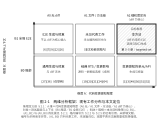

### 2.2 回归测试选择 / 变更影响分析（RTS / CIA）

经典 RTS 与变更影响分析在 (A1, B0) 已相当成熟，但技术路线与适用边界差异明显，逐篇看更能说明它们为何都停在源码层。

**增量覆盖与语义精化**。[19] 复用历史覆盖、只对变更部分重算，目标是让覆盖率分析在频繁提交下仍可负担；其结论是增量重算能显著降低分析开销，局限是映射粒度停在方法 / 代码单元。这一路线还隐含一个前提：历史覆盖可跨提交复用；在 E2E 中该前提并不天然成立，会话状态与页面跳转使覆盖记录难以直接对齐。[20] 进一步区分"改变语义的修改"与重构类修改，只对前者扩大选择集；其价值在于减少重构提交上的过选择，但仍以 Java 方法与测试为对象，不涉及路由与 DOM。

**服务与流水线场景**。[22] 以系统文献综述梳理微服务间的变更传播，[23] 用 Datalog 做语言无关的服务级影响分析，二者说明服务边界可以承载跨语言依赖，但粒度停在服务 / 接口；[25] 把选择与执行放进 CI 流水线，结论是工程阶段会影响实际收益，其成本模型却不含浏览器启动与页面加载；[65] 把回归条件写成可检验的形式化约束，结论是选择规则可以被验证，但框架停留在抽象层，未落到浏览器会话。

**统一与混合粒度的选择**。[21] 把不同类型的测试放进同一选择框架，主张用统一口径替代按套件各自选择；[24] 则把文件级与方法级依赖合并，结论是两级依赖互补优于单级。两者的共同前提仍是源码 / 字节码依赖图，无法表达"浏览器用例经过哪些页面与组件"。本文要补的正是这层映射：把 E2E 用例的覆盖边与 DOM 锚点一起纳入选择（§3.2、§3.4）。

**判定口径的扩展**。[64] 以命名信息近似依赖关系，主张在动态语言上以较低分析成本获得安全的选择；[26] 利用 TDD"先写测试"的结构约束缩小选择范围；[4] 用自然语言意图判断行为是否回归。三者都说明"受影响"可以超出语法 diff，但都没有浏览器执行上下文。[62] 从设备与流水线角度报告 Android instrumentation 的执行约束，结论是设备级成本主要来自环境，选择粒度仍是源码 / 模块。

**族缺口**：这些工作的覆盖 / 依赖映射止于源码 / 字节码层，**未跨越 B0→B1 的鸿沟**——E2E 测试与源码之间隔着路由、组件、DOM、定位器，单元 RTS 无法直接判定"哪条浏览器用例受影响"。

### 2.3 E2E / Web 测试生成

E2E 生成工作多落在 (A0, B1)，可按"测试意图从哪里来"分族评述。

**特征与场景驱动**。AutoE2E [6] 以特征描述为单位组织探索与生成，先从特征定位相关页面元素，再合成端到端用例，结论是特征级上下文能让用例贴近用户任务；场景引导移动 GUI 测试 [8]、ViMoTest [60] 与意图驱动的移动测试 [61] 分别把场景先验、ViewModel 场景规格和用户意图作为生成起点。这一族的共同点是"先有意图、再找路径"，不读取本次提交的 diff，因此无法回答"这次变更缺哪条测试"。

**图结构与组件抽象**。屏幕转移图 + LLM 生成 [7] 先构建页面转移图，再在图上约束生成路径，结论是图结构能减少无效跳转；VISCA [59] 从页面结构推断组件抽象，用组件级操作替代脆弱的元素定位，结论是抽象层提升了 E2E 的稳定性；GenIA-E2ETest [9] 的生成式流水线也属此类。它们优化的是"如何生成一条能跑通的 E2E"，而不是变更定向。

**变更感知生成**。提交回归测试生成 [3] 直接以提交为输入考察 LLM 能否产出回归测试；TestWeaver [52] 用执行反馈迭代生成回归用例；JIT catching [51] 在代码评审时即时生成捕获性测试；ChaCo [49] 以"变更行是否被覆盖"为目标；PR-aware 单测 [50] 把 PR 上下文纳入生成。这一族已经以 diff 为核心输入，但产出停在单元 / API 层，既没有浏览器会话，也没有路由与定位器。本文与它们的差别是：把"变更感知"推进到浏览器层，以路由为单位识别缺口，并用可直接执行与版本敏感两个条件约束生成物（§3.1、§5.2）。

**单元 / 组件层的方法供给**。LLM 与搜索式混合生成 [27][28][29][31][32] 覆盖了覆盖率平台期逃逸、上下文提示与测试语料训练等路线；代码上下文感知提示 [2] 与变异反馈驱动的生成 [30] 分别从上下文与判据两端改进生成质量；测试生成基准 [33]、工业级 TestGen-LLM 与 TestGen [34][47]、测试脚本生成与迁移 [35]、软件演化条件下的生成评估 [53] 以及自主 agent 测试代码研究 [63] 提供了可复用的判据与工程证据。这些结论构成本文生成环节的方法底座，但不解决 E2E 的变更定向问题。

**E2E 场景信号与数据集**。E2EGit [48] 提供 E2E 测试演化样本，面向 UI 视觉变化的上下文感知检测 [5] 与 E2E 脆弱性预测 [18] 提供可复用的场景信号，但均不以 diff 为选择或生成的核心输入。综述层面，LLM 测试生成 [42]、Web 测试 [43][44]、视觉 / 移动 GUI 测试 [45] 与代码模型能力演进 [54] 给出了领域图景与能力边界。

**族缺口**：变更感知生成几乎都在 (A2, B0)，E2E 生成几乎都在 (A0, B1)，**(A2, B1)——以 diff 为核心、为浏览器端到端缺口定向生成——基本空白**。

### 2.4 E2E / Web 测试修复

E2E 修复多为"失败后修测试"，可按修复对象与输入分族评述。

**面向 Web / E2E 的修复**。语义化 Web 测试修复 [12] 利用页面语义信息修复失效用例，结论是语义定位比脆弱选择器更稳健；引导 ChatGPT 修 Web UI 测试 [16] 研究修复时哪些属性更可靠，说明属性优先级会直接影响修复成功率；WEFix [13] 为 E2E flaky 测试生成显式等待，异步等待修复 [17] 从时间维度处理同一类问题，二者针对的是时序而非变更语义；自治修复多智能体案例 [10] 则给出这类方法在真实项目上的现实上限。这一族的输入是失败报告或页面状态，不以源码 diff 为核心上下文，也不产出可整体复用的 targeted 集。

**变更感知的测试修复**。TaRGET [11] 用语言模型修复受变更影响的测试，Fix the Tests [14] 以静态收集器加神经重排器补足上下文，单测更新 [15] 通过上下文收集与错误类型感知的迭代改写单元测试；三者的结论都支持"变更上下文能提高修复针对性"，但对象均是单元测试；其评测口径也多是"修复后单测是否通过"，而非"修复后能否重新进入回归选择集"，后者恰是本文关心的闭环可用性。UTFix [1] 是其中最接近本文的工作：它以变更为条件修复单元测试，并显式利用变更信息；其边界也很清楚——没有 DOM 与定位器概念，无法处理浏览器用例的断裂。本文与它的差别不在"是否使用变更"，而在把变更感知推进到浏览器层，并让修复服务于 targeted 集的整体可用性而非单条测试通过（§3.1、§5.3）。

**更广义的修复与维护**。模板式 APR [36]、flaky 测试修复 [37][56]、测试桩生成 [38]、自愈测试框架综述 [39]、工业测试维护中的 LLM 应用 [41]、APR 综述与 agent 可追溯性分析 [46][66]、知识注入式程序修复 [58]，以及测试修复在 LLM 单元测试生成中的作用 [57]，多以失败测试或缺陷本身为输入，而非应用 diff；灰文献综述 [40] 从工业实践印证了"维护成本高、上下文不足"这一共同痛点。

**真值数据**。ReproBreak [55] 提供可复现的 Web 定位器断裂真值，本身不是修复方法；本文用它构造 RQ3 的无泄漏评估池。

**族缺口**：E2E 修复**不以源码 diff 为核心上下文**，也不服务于一个 targeted 回归集的整体可用性；变更感知修复则停在单元层。

### 2.5 技术缺口与本方法定位

综合上述三族评述，现有工作在目标象限 (A2, B1) 留下三个技术缺口：

1. **缺源码↔浏览器的语义桥**：单元 RTS/修复的覆盖/依赖映射止于源码层；E2E 生成/修复又不以 diff 为核心。→ 本方法用 **Semantic UI Diff + 测试↔代码映射器** 显式建立该桥。
2. **缺可证明的召回保证**：RTS 工作多报经验 Safety，但 E2E 场景下缺少"与选择器无关"的真值定义与安全性论证，且未处理副作用经共享状态的间接影响。→ 本方法给出条件安全命题 + 非循环结果差异 oracle + 状态依赖闭包。
3. **缺端到端闭环与净收益量化**：现有工作多为单点（选择 或 生成），少有"选出受影响测试之后如何识别未覆盖 diff 并定向生成"的闭环，也少有"选择开销 + 执行时间 vs 全量"的净收益与资源量化。→ 本方法以选择与生成为主链路，把选择→运行→缺口分析→生成串成代码变更感知闭环，轻量修复仅作为支撑环节，并以净收益模型量化。

> **一句话定位**：现有工作要么"变更感知但停在单元层"（象限 `(A2, B0)`：[1][3][49][50][51][52]），要么"做浏览器 E2E 但与变更无关"（象限 `(A0, B1)`：[6][7][9][12][16]）。本方法在该组合上开展系统研究，并给出可执行的选择—缺口识别—生成闭环；`(A1, B1)` 与 `(A0, B0)` 两格的处置见 §2.1。

**表 2-1　两维象限 → 文献映射表**

| 象限（A 变更感知 × B 测试层级） | 代表工作 | 本文处置 |
|---|---|---|
| (A0, B0) 无 diff × 单元/组件 | 泛化生成与通用修复 [27][36] 等 | 背景引用，不逐篇穷举（§2.1） |
| (A1, B0) 文件/方法级 × 单元/集成 | 经典 RTS/CIA [19][20][21][22][23][24][25][26][64] | §2.2 逐篇评述 |
| (A2, B0) diff 定向 × 单元/API | 变更感知生成 [3][49][50][51][52]、变更感知修复 [1][11][14][15] | §2.3/§2.4 评述 |
| (A1, B1) 文件/方法级 × E2E | 工程实践中的文件级覆盖迁移（本文 `coverage_only` 基线所代表） | 相邻方向，机制未细化（§2.1） |
| (A0, B1) 无 diff × 浏览器 E2E | AutoE2E[6]、屏幕转移图[7]、语义修复[12]、WEFix[13] 等 | §2.3/§2.4 评述 |
| **(A2, B1) diff 定向 × 浏览器 E2E** | **本方法** | **研究空白 → 本文定位** |

---

## 第 3 章 方法设计

### 3.1 总体框架：五步闭环

记输入为旧版本 `V_old`、新版本 `V_new`、本次变更 `diff` 与既有 E2E 测试集 `T`。方法是一条以 diff 为核心输入、以**选择与生成为主链路**的五步闭环（整体结构见图 3-1，五步顺序与分支见图 3-2）：

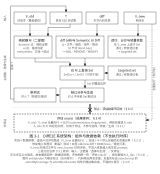

1. **建立旧版本覆盖映射**：在 `V_old` 上逐条运行 `T`，记录每条测试实际触达的源码文件、路由与组件，沉淀为 test-code graph `G` 的 `executes`/`navigates` 动态边（其测试↔实体投影记为 `M`）。
2. **分析本次代码变更**：解析 git diff 得到变更实体 `Δ`（文件/函数/组件/路由/UI 语义节点），并对 UI 源码做 Semantic UI Diff。
3. **选择相关 E2E 测试**：在 `M` 上做邻居查询，取覆盖信号臂与 UI 语义信号臂的并集 `Sel`。
4. **运行、分诊与轻量修复**：在 `V_new` 上运行 `Sel`；通过者直接进入 targeted set（**targeted set** 即第 ④ 步输出的目标测试集，是选择通过者与修复通过者的并集，也是本轮实际执行的用例集合）；失败者分诊为疑似回归或测试过时。对明显定位器/断言过时的样本，结合 diff/DOM/trace/Semantic UI Diff 给出轻量修复候选，修复通过后进入 targeted set；疑似回归不进入自动修复，排除出 targeted set，交人工判定（§5.3）；复杂真实修复不作为本文主贡献。
5. **缺口分析与生成**：对 diff 中未被已选/已修测试触达的部分进行带约束生成（必须触达 diff、含可解释操作路径、含变化相关断言、在 `V_new` 上真实通过）。**回填**：修复通过的测试与生成通过的测试一并并入 `T`，与既有测试同等对待——否则下一轮第 ① 步建边时这些用例不在集合内，覆盖信息不完整；它们在后续提交的第 ① 步中被逐条插桩执行、建立覆盖边，`M` 随该次提交增量更新。于是跨提交看，`T` 与 `M` 共同演进，本步的输出重新成为下一步的输入，五步由此闭合成环，而不是一次性的单向流水线。

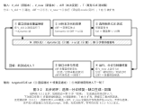

> **无信息泄漏纪律（贯穿全程）**：选择只用 `V_old` 覆盖 + diff；`V_new` 全量执行仅用于构造评估 oracle，不参与选择。修复的输入只能是"旧（断裂）测试 + 应用源码 old/new diff + DOM/trace/候选元素"；`V_new` 的测试文件与 `new_locator` 只能用于评估，绝不进入修复输入或生成 prompt。

### 3.2 测试↔代码映射器：三层 test-code graph

映射器 `G=(V,E)` 是连接源码实体与测试的**三层 test-code graph**（图 3-3）。它把"测试跑过哪些代码"与"代码之间如何相连"放在同一张带类型的图上；旧版的扁平二部映射器只是它的投影。

**节点** `V = V_code ∪ V_test`：
- `V_test`：每条 E2E 测试，id 取 `"<spec 文件> > <用例标题>"`。
- `V_code`：文件 `file`、函数 `function`、方法 `method`、类 `class`、变量 `variable`、类型 `interface`、路由 `route`、组件 `component`、UI 语义节点 `ui`。UI 节点 `{kind,key}` 的 `kind` 取六类信号：`text`（可见文本，以及 `name`/`title`/`placeholder` 三类可读文本属性）、`testId`（`data-testid`/`testID`）、`role`、`aria`（`aria-label`）、`href`、`handler`（`onClick`/`onSubmit` 所指具名处理函数，属**非属性类信号**）；`key` 取该类信号的值（如 `testId=cart-add`、`text=Add to cart`、`handler=handleAdd`）。

**三层边**（每条边带 **provenance** 维度：`dynamic` 运行时插桩、`symbolic` AST/静态抽取、`heuristic` 推断/匹配）：

1. **结构层（code→code）**：`contains`（文件/类/函数→其成员）、`imports`（文件→导入模块/符号）、`calls`（函数→被调函数，`heuristic`，只用于排序与上下文，严禁参与缩减）、`renders`（路由或组件→被渲染组件）。
2. **路由层（route）**：路由节点与 `renders` 边。路由识别覆盖两类真实形态：SvelteKit 文件路由（`+page.svelte`，含 `[slug]`→`:slug` 与 `(group)` 分组）与 React Router（对象式 `{path, element}` 与 JSX `<Route path element>`）。
3. **测试证据层（test→code / function→variable）**：`executes`（test→function/method，`dynamic`，V8 函数级覆盖）、`navigates`（test→route，`dynamic`）、`coversFile`（test→file，`dynamic`，文件级覆盖，供不可归因文件的保守回退使用）、`asserts`（test→UI 节点，`symbolic`，即旧称 `ui` 边，来源是测试源码中的定位器/断言字面量）、`references`（function→模块级变量，`symbolic`，value-reference）。

**投影视图**：把测试证据层投影到"实体—测试"对，得到带类型的二部索引 `M ⊆ E×T`（`E=E_file∪E_func∪E_route∪E_comp∪E_ui`），即旧版扁平映射器。它是 `G` 的**逻辑视图**，不是独立于 `G` 的第二套模型。反向映射 `entityIndex[e] = { t ∈ T | (e,t) ∈ M }` 供选择查表；实现上按边集扫描即可，无需持久物理结构。**选择**即对 `Δ` 中每个实体取 `entityIndex[e]` 求并；**修复/生成**沿 `asserts`/UI 边找锚点。选择查询复杂度为 `O(变更实体数 × 平均度)`。

**召回承诺只依赖动态边**：`executes`/`navigates` 是安全底座；`references`（静态）仅在可证明完备时才允许用于缩窄（H2′，§3.4）；`calls`（heuristic）不参与任何缩减；`asserts`/UI 边只用于精度细化与修复/生成上下文。这与旧版"dynamic 边保召回、其余边只增精度"的原则一致，但把边放在同一张图上，避免"二部图"与"四层归因"两套叙述割裂。

**构建（一次全量）**：`extract.mjs` 用 tree-sitter 对每个文件做**单文件纯提取**（节点 + `contains`/`imports`/`calls`/`renders` 边 + 字节跨度；单文件纯性是"增量==全量"成立的前提）；`resolve.mjs` 做名字解析，`semanticResolve.mjs` 用 TypeScript typeChecker 穿透 `import { A as B }` 别名、barrel 重导出与遮蔽；`testEdges.mjs` 把 V8 函数级覆盖接成 `executes`/`navigates`，把测试源码的定位器/断言接成 `asserts`。动态边成本 ≈ `O(T_run(all))`（一次性）；静态边 `O(|源码| + |T|×|锚点|)`。

**增量维护（关键）**：给定上一版图与本次 `diff`，只重解析变更文件、只对触达变更实体的测试重插桩，其余边复用：

```
update(G_old, diff) -> G_new:
  Δ = changedEntities(diff)
  T_touch = ∪_{e∈Δ} entityIndex[e]
  for f ∈ changedFiles(diff):  reExtract(f)           # 结构/路由/UI 边
  for t ∈ T_touch:             reInstrument(t, V_new) # executes/navigates 边
  其余边从 G_old 复用；重建受影响部分的 entityIndex
```

增量复杂度 `O(|T_touch|×单测插桩 + |changedFiles|×静态抽取)`，与"变更规模"成正比而非"全量规模"。**正确性条件**：未触达变更实体的测试在 H1–H3 与 H2′（§3.4）下覆盖不变，故复用旧边安全。**摊销结论**：首次全量构建 `C_build` 单列；此后每次 CI 的更新成本 `C_update ≪ C_build`，使长期 CI 中平均每提交的 `T_select` 远小于 `T_run(all)`。若检测到插桩盲区或索引偏差超阈值，则触发强制重建或回退全量，保证安全优先于效率。

图 3-3 给出该图的**测试↔实体投影视图**（二部索引 `M`）与增量更新；三层结构的完整边类型以本节文字为准。

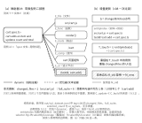

### 3.3 Semantic UI Diff：源码 diff ↔ 浏览器操作的桥

Semantic UI Diff 从新旧版本 UI 源码（JSX/TSX/HTML）抽取 UI 语义节点并比较，得到 ADD / REMOVE / MODIFY 三类语义变更。三类变更均以**节点**为单位记录（MODIFY 是节点级，不是 key 级）：同一 UI 语义节点在新旧版本中都被匹配到、但内部字段取值发生变化，记一条 MODIFY，其记录内再以字段级 `changes` 给出逐字段的改前/改后。节点身份先按 `key` 判定；若 `key` 变化，则回退到"同标签 + 同 `testId` 或同 `onClick` 处理函数"判为同一节点，记 MODIFY 并列出变化字段（§5.5 的 C1 中 `testid:turquoise-btn` 的 `testId` 变化即由此捕获）。两轮都匹配不到的旧节点记 REMOVE，新节点记 ADD；例如按钮文案 `Red`→`Crimson` 且无 `testId`／`onClick` 可回退时，旧锚值 `button:text:Red` 与新锚值 `button:text:Crimson` 分别落 REMOVE 与 ADD，随后由修复阶段的定位器改写接续处理（§5.5）。它在三阶段发挥作用：

- **选择阶段**：把 UI 变更与测试定位器（text/testId/role/href 等）做语义关联，在覆盖粒度过粗时提供更细的定位锚值（本文仅在单组件应用上实测到精度提升，见 §5.5 C1；文件粒度主体上未带来选中集合变化）。
- **修复阶段**：为失效的定位器或断言提供基于语义锚值替换的修复候选（如 `text: "Red"→"Crimson"`）。
- **生成阶段**：指出哪些新增 UI 节点或变化路径尚无测试覆盖，作为缺口生成的目标。

这是本方法的核心连接机制：解决"源码 diff 很难直接对应到浏览器中的用户操作和测试脚本"这一 E2E 场景特有的断点。

**节点抽取（面向真实工程的工程化）**：真实前端极少直接使用原生 `<button>/<a>/<input>`，而是封装自设计系统的组件（`<Button>`、`<TapField>`、`<View>` 等）。因此抽取规则不以标签名白名单为唯一依据：**凡携带定位锚点属性者**（`data-testid`/`testID`/`aria-label`/`role`/`name`/`href`/`title`/`placeholder`）的任意 JSX 元素均纳入 UI 语义节点，与原生交互标签取并集。**属性集与 `kind` 的归档规则**（与 §3.2 的六类一一对应，双向可推、无悬空项）：`data-testid`/`testID`→`testId`，`role`→`role`，`aria-label`→`aria`，`href`→`href`，`name`/`title`/`placeholder`→`text`（可读文本属性）；`text` 的另一来源是元素可见文本内容；`handler` 无对应 HTML 属性，只取自 `onClick`/`onSubmit` 的处理函数名，故属性集与「属性类 kind」严格对应，`handler` 作为唯一的非属性类信号单列，不构成悬空项。可见文本仅折叠"类文本"表达式（`{t('Save')}`、`{label}`），跳过内嵌子元素树的长表达式以避免把整棵子树误当文本而产生噪声锚值。

**信号→测试的匹配（精度与召回的工程权衡）**：将变更（REMOVE/MODIFY）的锚值与测试源做关联时，要求锚值以**引号字面量**形式出现（`'sig'`/`"sig"`/`` `sig` ``），与真实定位器写法一致（`getByTestId('amount-input')`、`getByText('No payees found.')`）。这消除了裸子串匹配对短/通用信号的误匹配（如 `date` 命中 `update`/`validate`）。此外，真实套件普遍采用页面对象模型（Page Object），定位锚点位于被 spec 导入的辅助模块而非 spec 顶层；故匹配时对 spec 做 1–2 层**本地导入闭包**展开（`import … from './page-models/…'`），将页面对象源码并入待匹配文本，避免漏选。

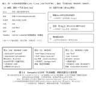

### 3.4 召回保证：定义、命题与边界

**真正受影响集 `A*`（与选择器无关，金标准）**：以测试在两版本上的可观测结果定义，不依赖任何选择算法。记 `outcome_V(t) = (status, fingerprint)`，`status ∈ {pass, fail, error, absent}`，`fingerprint` 为关键断言的可观测取值指纹（捕捉"都 pass 但断言观测值变了"）。则

```
A* = { t ∈ T : outcome_{V_old}(t) ≠ outcome_{V_new}(t) }
```

之所以不用覆盖定义 `A*`：覆盖型 affected 与选择器同源，会使 Safety 近乎自证。`A*` 改用真实结果差异定义，**打破循环**。

**选择规则 `Sel`**：覆盖信号臂与 UI 语义信号臂的并集。

```
SelCov = { t : cov(t) ∩ Δ ≠ ∅ }
SelUI  = { t : src(t) 引用了 Δ 中的 UI 语义节点 }
Sel    = SelCov ∪ SelUI
```

**定义（安全 Safe RTS）**：选择规则安全 ⟺ `A* ⊆ Sel`（召回率=1，不漏测）。

**命题 1（覆盖臂即安全）**：在以下假设下，`A* ⊆ SelCov ⊆ Sel`：
- (H1) 确定性：测试结果只由被执行代码与固定输入决定（无 flaky）。
- (H2) 覆盖完备性：`cov(t)` 记录了 `t` 在 `V_old` 上执行到的所有源码实体。
- (H3) 变更实体完备性：`Δ` 覆盖了本次 diff 引入的所有语义改动所在实体。

**证明（逆否）**：设 `t ∉ SelCov`，则 `cov(t) ∩ Δ = ∅`。由 (H2)，`t` 执行轨迹涉及的实体 `⊆ cov(t)`，皆不在 `Δ`；由 (H3)，所有语义改动都在 `Δ` 内，故 `t` 路径上代码语义在两版本间未变；由 (H1)，相同语义+相同输入 ⇒ `outcome_{V_old}(t) = outcome_{V_new}(t)`，即 `t ∉ A*`。取逆否得 `A* ⊆ SelCov ⊆ Sel`。∎

**推论**：UI 语义臂 `SelUI` 只做并集（只增不减），不可能破坏召回；它在并集中保证召回，并可能影响 Precision（新增选中项均受影响时可提高，含无关项时则降低），同时提供修复/生成锚点。这与"宁可多跑也不漏"一致：召回由 `SelCov` 保证，`SelUI` 是兜底而非增益来源。当对召回的信心高于对成本的敏感度时，本方法总是包含整个 `SelCov`，不做任何裁剪；本文 50 个过渡上 `SelUI` 未改变最终选中集合（§5.1）。

**四层归因（`SelCov` 的实现）**：本文把 `cov(t)` 从"文件粒度"细化为**函数/变量/路由粒度**（§3.2 的 test-code graph），据此把选择实现为四层归因（§5.1.1）：

1. **函数级 `executes`**：`cov(t)` 记录 `t` 执行到的具名函数（H2 从"文件级"细化为"函数级"），改哪个函数 → 选执行它的测试；
2. **变量级 `references`**：模块级变量的改动沿"变量 → 读它的函数"边传播（value-reference），替代"改文件 → 选所有碰该文件的测试"；
3. **路由级 route-diff**：路由表 ADD 选 0（新路由无测试访问）、REMOVE/MODIFY 选 `navigates` 到该路由的测试；
4. **文件级回退 + config 全量**：无法归因的改动（config/flag/环境、或"无 reader 的变量"）保守回退文件级甚至 retest_all。

**召回的安全边界（重要修正）**：四层归因把文件级覆盖缩窄到函数/变量/路由粒度，因此召回除 H1–H3 外还依赖两条**归因完备性**前提，合称 (H2′)：

**(H2′-a) 静态引用边完备**：仅当变量**未被导出**且所在文件**无动态属性访问**（`obj[name]`、`window[k]`）时，才允许用 `references` 缩窄（`select.mjs#isSafelyNarrowable`）；否则回退文件级。启发式 `calls` 边严禁参与缩减。该判据有单测覆盖（导出变量、动态访问两种情形均回退）。

**(H2′-b) 动态函数身份可匹配**：`executes` 边由 V8 函数级覆盖的 `functionName` 与静态函数节点按 (文件, 名字) 匹配得到。V8 对匿名箭头/高阶组件包装报空名（`React.memo(() => …)`、`forwardRef(…)`、`export default () => …` 实测均为 `''`），本文实现**显式过滤 `functionName === ''`** 以排除 Vite "import-即-覆盖"的顶层模块求值假阳性（§5.1 表 5-4）。这一过滤的代价是：匿名函数不会被当作独立可选中实体。为不因此漏选，归因采用三条保守规则：

1. **归到外层具名实体**：改动行若落在匿名回调内，行号→实体映射会同时命中其外层具名函数/组件，`executes` 边按外层实体选择；常见 React 组件（`const Foo = () => …` 由 V8 推断名字）因此不受影响。
2. **不可归因即回退**：既有文件若没有产生任何函数/变量/路由实体（顶层副作用、无法解析的语法等），且改动**不是纯注释/空行**，则整文件回退到文件级选择（`select.mjs#fallbackFiles`）；回退使用测试→文件的真实覆盖边 `coversFile`，而不是只沿具名函数的 `executes` 边找测试——否则"只有模块顶层求值、没有具名函数"的文件（数据模块、`export default () => …`）会回退成空集。纯注释改动选 0 是正确的，新增文件/新增声明也选 0——旧版本中不存在，旧测试不可能执行它。
3. **限定名错位用唯一同名解析**：行号→实体返回裸名，而图节点用限定名（`file::Class::method`、`file::outer::inner`）。先按精确 id，再按"同文件唯一同名"解析（`attribution.mjs#resolveEntityNode`）；同名歧义才回退文件级。

纯注释判定不是按行首字符猜测：`isCommentOnlyChange` 用 TypeScript scanner 证明改动行的每个非空白字符都位于注释 trivia 内，模板字符串中的 `//` 不会被误判；JSX `{/* … */}` 的包裹花括号放行。该组判据有单测（24 项）覆盖；`out/attribution_audit.md` 对受控主体 24 个过渡逐文件审计：3 个"零实体"文件全部是纯注释，回退 0 次，故表 5-1 的 0.8889 不变；`out/attribution_audit_actual_desktop.md` 对真实项目 9 个过渡审计出 1 个非注释零实体（`customThemeCatalog.json` 数据文件），按规则回退文件级；该文件未被任何 E2E 覆盖记录命中（`cov_pertest` 无匹配），故回退为 no-op，表 5-4 的 9 过渡数字不变；测试文件已从应用源码 Δ 中排除。

据此，命题 1 的条件安全在启用四层归因时扩展为 **(H2′)：对被裁剪的变量，其静态引用边集合是完备的；对动态边，函数身份可按名字匹配，或由上述保守规则触发回退**。局限是：该方法依赖未被压缩/混淆的函数名（实验均在 Vite dev server 下进行）；生产构建的函数名改写与字节偏移级匿名函数识别列为后续工作（§5.7）。**若上述规则均未触发而函数身份仍不可匹配，则存在理论漏选风险**——本文不声称 H2′ 在任意构建形态下成立。

**表 3-1　命题 1 的假设、失效场景与处理**

| 假设 | 失效场景 | 后果 | 处理 |
|---|---|---|---|
| H1 确定性 | flaky、时间/并发相关 | 结果差异非 diff 引起 → 污染 `A_obs` | 多次重跑取稳定结果；flaky 单列不计入主 `A_obs` |
| H2 覆盖完备 | 动态 import、SSR、未插桩第三方 | `cov(t)` 漏记 → 可能漏选 | 插桩自检；盲区实体做保守纳入（路由/组件粒度兜底） |
| H3 实体完备 | 配置/数据驱动改动；**副作用经共享状态** | 改动不在 `Δ` → 可能漏选 | 副作用交 3.5 状态闭包；配置/数据纳入 `Δ` 扩展 |
| H2′ 归因完备 | 匿名箭头/HOC、类方法限定名、导出变量、动态属性访问、压缩构建 | `references`/`executes` 漏记 → 可能漏选 | 唯一同名解析；不可归因回退文件级；纯注释/新增声明豁免；压缩构建列为局限 |

命题 1 是**条件安全**（在 H1–H3 与 H2′ 下）。论文显式陈述这四项假设，并用经验真值（第 5.1 节）检验其在实践中是否被违反。

**经验召回验证（非循环）**：在 `V_old/V_new` 全量执行，用结果差异取 `A_obs`（`A*` 的经验实例），计算 `SafetyEmp = |Sel ∩ A_obs| / |A_obs|`，目标=1.0；任何 `A_obs \ Sel ≠ ∅` 的个案逐条审计并归因 H1/H2/H3 哪条失效，不得掩盖。为扩大真值规模，对 `Δ` 中实体注入小型语义变异、重跑全量得到 `A_obs^mut`，做主动压力测试。

### 3.5 副作用与状态依赖闭包

经典覆盖型 RTS 的安全性依赖"测试隔离"。当测试经**共享状态**（localStorage/cookie/全局变量/后端持久化/外部服务）耦合时，一个不直接触达 `Δ` 的测试 `t`（`cov(t)∩Δ=∅`）可能间接受影响——这是 H3 失效的典型形态。

定义状态资源集 `R`、读写足迹 `rw : T → 2^{R×{read,write}}`、状态依赖关系 `t_i ⤳ t_j`（`t_i` 写、`t_j` 读同一资源，或执行序耦合）。**安全闭包**：

```
SelClosed = { t : t 与某个 s ∈ Sel 在 ⤳ 关系下共享资源 } ∪ Sel
         （方向无关的传递闭包：既纳入 t 依赖的状态生产者 s，也纳入依赖 s 的下游读者 t）
```

**命题 2（放宽 H3 后的安全性）**：在 (H1)(H2) 成立、允许副作用（放宽 H3）下，若状态足迹 `rw` 完备，则 `A* ⊆ SelClosed`。该闭包**不含任何结果真值**（不引用 `A*`），只依赖测试间的读写足迹，因此可在选择阶段计算（与 §3.1 的无泄漏纪律一致）；其代价是 `Reduction` 下降，安全性以 `rw` 完备为前提。代价是 Reduction 下降——这是"召回不可妥协"下可接受的权衡。选择器以可选开关 `--state-closure`（默认开，体现保守取向）接入。

**工程边界（原型）**：当前足迹采集只拦截 HTTP 请求，`GET` 判 read、其余判 write，资源键直接取请求路径；`localStorage`/`cookie`/数据库表尚未自动 Hook。对 `POST /api/search` 这类读操作、以及 `POST /api/orders` 与 `GET /api/orders/123` 这类路径键不一致的 REST/GraphQL/RPC 语义，精确路径键会漏建或误建 `t_i ⤳ t_j` 边。因此命题 2 的"`rw` 完备"在原型中只对同构路径的 HTTP 足迹近似成立；生产级实现需 URL 归一化（剥离动态 ID 段）与 GraphQL/POST 查询语义识别。

### 3.6 净收益成本模型

在召回硬约束下最小化执行成本：`min Cost(Sel) s.t. SafetyEmp(Sel)=1`，次目标 `max Reduction = 1 − |Sel|/|S|`。时间分解与净收益：

```
T_full        = 全量执行 S 的 wall-clock
T_select      = T_mapper_update + T_diff_analyze + T_select_compute
T_run(Sel)    = 执行选中子集的 wall-clock
NetSaving     = 1 − (T_select + T_run(Sel)) / T_full
TimeReduction = 1 − T_run(Sel) / T_full          # 只看执行
SelectionTax  = T_select / T_full                 # 选择本身的"税"
```

**关键诚实点**：`Reduction`（用例数比例）≫ `TimeReduction`（时间）是常态——E2E 用例时长高度不均，少跑的多是短用例；且 `T_select>0` 进一步吃掉收益。三者必须解耦报告。**盈亏平衡**：当 `NetSaving>0`（即 `T_select+T_run(Sel)<T_full`）方法才划算。除 wall-clock 外，报告 machine-minutes、峰值并行度、LLM token/$ 等非时间资源。公平对比协议：full 与 selected 用同一命令模板、同 `--workers`、同覆盖设置；selected 多个 spec 一次性传入单次调用；每臂重复 `R≥3` 取 median/IQR；`T_select` 单独计时并纳入总时。

### 3.7 判定规则、prompt 与可复现参数

本节集中写清"靠什么判、按什么约束生成、用哪些参数"，使读者不读代码也能判断方法可复现；实现叙述见 §4.2–§4.5。

**（1）过时三分类的判定规则**。判类完全由离散结构证据决定，**不使用任何相似度或编辑距离阈值**：若本次变更存在结构性定位信号（旧 `testId` → 新 `testId` 的映射 `sigMap` 非空），或失败测试的源码引用了被改写的 `testId`，判 `STRUCTURAL_ONLY`；否则若源码文本片段映射 `segMap` 非空，判 `EXPECTATION_CHANGE`；两者皆空判 `SUSPECTED_REGRESSION`。第三类取保守方向：不自动改写、排除出 targeted set、交人工判定（§3.1）。

**（2）规则修复的两条路径**。定位器修复以"`tag` 相同且可见文本完全相同"为唯一配对条件，在 old/new 的 DOM 信号集之间建立旧 `testId` → 新 `testId` 的映射；未变的 `testId` 跳过，且新 `testId` 不得被旧集合中任何节点占用。断言修复逐行抽取模板字符串的静态片段与单/双引号字符串，归一空白后丢弃长度 ≤1、不含拉丁字母、以及 kebab-case 形式的标识符（如 `data-testid` 的取值，不视为 UI 文案），再把"仅旧版本出现的片段"与"仅新版本出现的片段"按出现顺序一一配对替换。两类修改都只产出候选编辑，是否通过以在新版本上重跑为准（§5.3 的 rule 臂）；同样**无阈值参数**。

**（3）prompt 的结构与硬约束**。三处 prompt 均为"任务 + 输入 + 硬约束 + 输出格式"四段式：

- **缺口生成（diff 臂）**：声明"新增路由 `<route>` 且无 E2E 测试"并附该路由源码；硬约束为只从 `./fixtures` 导入 `{ test, expect }`、导航到 `/#<route>` 并执行主交互、断言一个可见结果，且只输出一个 TypeScript 测试。
- **无 diff 基线**：同一任务但不提供变更信息，只给应用名并允许自选"有意义的用户流程"；同样限定相对导航、禁止外部站点、只输出测试。
- **修复（RQ3）**：声明只修断裂的 locator/断言；输入为断裂测试与 old/new 应用源码，三者各截断至 3000 字符；**不含**新版本测试文件与新定位器（无泄漏边界，§3.1）。

三处输出都先去掉 Markdown 围栏再写入单个 spec 文件；生成用例必须在新版本真实执行并通过，才计入可执行率。

**（4）模型与调用参数**。provider 依次探测 `OPENAI_API_KEY`、`DEEPSEEK_API_KEY`、`ANTHROPIC_API_KEY`，默认模型可用 `LLM_MODEL` 环境变量覆盖；本文真实数字：生成（RQ2）与受控修复（RQ3 n=4）来自 `deepseek-v4-pro`，批量 ReproBreak 修复（RQ3 414 条）来自 `deepseek-v4-flash`（`deepseek-v4-pro` 为推理模型、单次约 80s，414 条批量修复不可行，见 §5.7）；备选 `gpt-4o-mini` 与 `claude-3-5-sonnet-latest`（后者固定 `max_tokens=1200`，前两者不设上限）。生成与修复调用不设 `temperature`；人工校准流程显式取 `temperature=0`（§5.6）。无 key 时返回确定性模板，链路可离线复现（§4.5）。

**（5）评估参数**。每个缺口注入至多 3 个变异体（`k=3`），`change_sensitive` 要求在 V_new 通过且在 V_old 失败，自动语义有效性为 `executable ∧ change_sensitive ∧ killed>0`；§5.2 的杀伤率分母即该缺口实际注入的变异体数（至多 3），与本节参数一致。变异算子与指标定义见 §5.2 首段；RQ3 的规则臂与 LLM 臂分别对应本节（2）与（3）。

---

## 第 4 章 原型实现与实验设置

### 4.1 实现总览与技术栈

DiffE2E 由五个部分组成，代码位于仓库 `diffe2e/`：

- **纯函数内核** `pipeline/src/`（20 个顶层模块 + `graph/` 9 个建图模块 + `llm/client.mjs`，以纯函数为主、IO 集中在实验层与客户端）：diff 解析、覆盖映射与路径归一、CDP 覆盖注入的纯函数部分、双信号选择、JSX 语义 UI Diff 与实体索引、覆盖缺口计算、生成与修复的模板/prompt 构造、过时三分类、状态依赖图与闭包、两类 oracle、指标与统计、报告渲染、可插拔 LLM 客户端；`graph/` 承担 §3.2 的三层建图（`extract`/`resolve`/`semanticResolve`/`fileRoutes`/`testEdges`）、四层选择（`select`）、增量工作区（`workspace`）与归因完备性兜底（`attribution`）。
- **实验驱动** `experiments/`：`lib.mjs` 提供 replay 原语（checkout、跑套件、读覆盖、解析失败），`run_rq1/rq2/rq3.mjs` 与 `compute.mjs` 负责逐过渡编排，`analyze.mjs`/`aggregate.mjs` 出统计与图，`run_rq4_cost.mjs`/`run_rq4_batch.mjs`/`run_llm_cost.mjs` 做成本测量与估算，`uidiff_loop.mjs`/`run_c1_dynamic.mjs` 做 JSX 闭环的静态与动态案例。
- **真实项目适配** `experiments/real/engine.mjs` 与 `realproj/`：前者把"安装依赖—注入 CDP 覆盖—跑套件—归因覆盖"抽象成与具体项目无关的适配器；后者做可插桩闸门与 ReproBreak 修复实验。
- **被测主体** `subject/`：`base/` 是受控应用与既有 E2E 套件，`history/seed.mjs` 生成带 tag 的嵌套 git 历史与 `manifest.json`，`sideeffect/` 是共享状态对照。
- **人工校准** `experiments/annotate/`：盲评包生成、预标注重跑、一致率统计、作者盲评回填与 κ 渲染。

技术栈：Node.js（ESM、`node:test`）、Playwright + Chromium、CDP `page.coverage`（V8 覆盖）与 istanbul（Vite 项目走 istanbul）、git、Python3（仅在读取 ReproBreak SQLite 时使用）。图 3-1 的每个组件都落在上述某个组成部分内：输入与 `Sel` 查询由 `experiments/lib.mjs` 与 `pipeline/src/selector.mjs` 承担，映射器两条边与实体索引见 §4.2，Semantic UI Diff 对应 `uidiff.mjs`/`astEntities.mjs`，运行—分诊—修复对应 `run_rq3.mjs` 与 `repair.mjs`，缺口生成对应 `generate.mjs`，评估 oracle 与全量执行对应 `oracle.mjs`/`outcome_oracle.mjs`（仅评估，§3.4）。

### 4.2 模块划分与职责

**（1）变更解析与覆盖归因。** `diff.mjs` 的 `parseUnifiedDiff` 把 `git diff --unified` 文本解析为"文件 → 新文件行号集合 / 旧文件行号集合"，`changedFiles` 给出文件级视图，这就是 Δ 的来源。`coverageMap.mjs` 提供 `fileLevelFromCDP`、`normalizeCovRecords` 与 `intersectsChange`，把 CDP 原始覆盖记录压成"测试 → 执行过的文件集合"，并做 `/src/x.js` 与 `src/x.js` 的归一；`covpath.mjs` 的 `toRepoRel`、`selectByGenericCoverage` 处理真实项目中绝对路径、`file://` URL、`/@fs/` 前缀等形态，使同一套选择逻辑可用于任意目录布局。`astEntities.mjs` 的 `changedEntities`/`changedEntitiesFromCode` 用 TypeScript 编译器 API 把变更行号映射到所属函数/组件，是图 3-1 中实体索引（该图标注为 entityIndex，代码侧无同名变量）的支撑。

**（2）覆盖注入。** `covinject.mjs` 是"让任意 Playwright 项目产出逐测试覆盖"的关键：它不改业务代码，只透明改写 spec 的导入语句，把 `@playwright/test` 换成收集 `page.coverage` 的 fixture（`rewriteSpecImport`、`covFixtureSource`、`covFixtureSourceMulti`、`covWrapFixtureSource`），再用 `srcLeaf`、`cdpUrlToLeafRel`、`mapLeafRelToRepoRel` 把浏览器里的 JS URL 反推回仓库相对路径。因此真实项目无需预插桩即可获得与受控主体同构的覆盖数据；`experiments/real/engine.mjs` 的 `installLive`、`injectCdpCoverage`、`runSuiteLive`、`loadCovLive` 负责这一层的 IO 编排。

**（3）选择。** `selector.mjs` 只有三个导出：`selectByCoverage`（覆盖边与 Δ 相交）、`selectByUiLocator`（测试源码引用的锚点与变更/删除的 UI 节点相交，信号取 `text/testId/ariaLabel/name`）、`select`（两者并集，即 `dual`）。`dual` 的"只增不减"是并集构造的直接结果，也是 §3.4 条件安全命题的实现形态；`uidiff_only`、`coverage_only` 两个消融臂分别只调用前两个函数。

**（4）语义 UI Diff 与状态闭包。** `uidiff.mjs` 的 `extract`/`extractFromCode` 从 JSX/TSX 抽取可见与可交互节点，`semanticDiffNodes` 按键匹配后产出 `ADD/REMOVE/MODIFY` 三类；非 JSX 主体用 `domdiff.mjs` 的 `changedUiSignals`/`selectByDomDiff` 作为结构等价物（只取"旧版本中存在、新版本消失"的 `data-testid` 或可见文本，并按引号锚定匹配，避免短词误命中）。`statedep.mjs` 的 `buildStateGraph` 按读写足迹建测试间状态图，`closeSelection` 对选择做**保守的无向传递闭包**（沿共享资源扩张，不依赖任何结果真值），用于 §3.5 的副作用命题。**足迹来源（如实说明）**：当前 side-effect 受控主体通过 Playwright 网络拦截自动采集——`request.method()==="GET"` 记为 read、其余记为 write，资源键取请求路径；`localStorage`/`cookie` 与后端数据库表的自动 Hook 尚未实现，需声明式标注或后续扩展。因此该闭包的安全性以"HTTP 层足迹完备"为条件，属 H3 的放宽形式。

**（5）运行分诊与修复。** `staleness.mjs` 的 `classify` 用两份证据判类：`sigMap`（定位器结构性变化）非空或失败用例引用了被改 `testId` → `STRUCTURAL_ONLY`；否则 `segMap`（源码文本片段变化）非空 → `EXPECTATION_CHANGE`；两者皆无 → `SUSPECTED_REGRESSION`。`repair.mjs` 的规则臂包含 `signalMap`（按 tag + 可见文本把旧 `testId` 映射到新 `testId`）、`repairLocators`、`textSegMap`/`repairAssertions`，并统一由 `repairFromUiDiff`/`repair` 输出候选改写。`run_rq3.mjs` 只对内部常量 `BREAK`（`locator_break`、`assertion_break`）两类过渡执行修复，LLM 臂的 prompt 只含"断裂测试 + 应用 old/new 源码切片"，不含新版本测试文件与新定位器（§3.1 的无泄漏边界）。

**（6）缺口生成。** `gap.mjs` 的 `coverageGap` 以"变更单元 − 已选/已修测试覆盖单元"求差；`generate.mjs` 先 `extractDomSignals` 抽 `data-testid`+标签+可见文本，`buildSpecTemplate` 生成确定性兜底 spec，`generateForGap` 在有 key 时把"新增路由 + 源码 + 断言可见结果"的要求交给 LLM；无 diff 基线走 `buildPromptNoDiff`（只给应用名、不给变更）。`cleanGeneratedSpec` 去掉模型输出里的 Markdown 围栏。生成用例写入 `tests/` 后在 V_new 上真实执行，并与 V_old 做差分。

**（7）评估与统计。** `oracle.mjs` 的 `buildAffected` 用 V_new 覆盖求受影响集（覆盖型 oracle）；`outcome_oracle.mjs` 的 `outcomeSignature`/`buildAffectedByOutcome`/`safetyEmp` 用测试结果签名构造非循环 oracle `A_obs`（§3.4）。`metrics.mjs` 给出 `selectionMetrics`、`selectionChangeCoverage`、`finalChangeCoverage`、`targetedSetUsability`；`stats.mjs` 提供 `mcnemar`、`cliffsDelta`、`wilcoxonSigned`、`bootstrapCI`、`cohenKappa`，bootstrap 用 `mulberry32` 种子化 PRNG 保证可复现。

**（8）LLM 客户端。** `llm/client.mjs` 的 `detectProvider` 依次探测 `OPENAI_API_KEY`、`DEEPSEEK_API_KEY`、`ANTHROPIC_API_KEY`，都没有则返回 `stub`；`createClient` 在无 key 时返回调用方传入的 `fallback` 模板，使全链路可离线确定性复现，有 key 时调用对应 chat 接口并把 usage 记录到产物。论文中的真实数字均来自 DeepSeek 臂。

**（9）test-code graph 建图管线（`pipeline/src/graph/`）。** 第 3.2 节与第 5.1.1 节的核心方法在此实现，共 9 个模块，按"提取→解析→接线→查询"分层；其中五个核心建图模块如下（另有 `graph.mjs`/`index.mjs` 负责装配、`select.mjs` 承担四层选择与回退、`workspace.mjs` 管理增量工作区）：

- `extract.mjs`：用 **tree-sitter**（typescript/tsx 语法）做**单文件纯提取**——产出 `file/function/method/class/variable/interface/route` 节点与 `contains`/`imports`/`calls`/`renders` 边，并保留字节级跨度（`startByte/endByte`）。单文件纯性（输出只依赖该文件源码）是"增量 == 全量"能够成立的前提；对无法解析的超大文件降级为 file-only 节点，不中断建图。
- `resolve.mjs`：**名字解析层**——把 `call::<name>` 解析为可见的导出符号（同文件或经由 import），跨文件调用据此连边。
- `semanticResolve.mjs`：**TypeScript typeChecker 语义解析**——把文件写入临时目录后 `createProgram`，用 `getSymbolAtLocation` + `getAliasedSymbol` 穿透 `import { A as B }` 别名、barrel 重导出与遮蔽。这是相对纯名字解析的优势所在。
- `fileRoutes.mjs` / `extract.mjs` 的路由分支：识别 SvelteKit 文件路由（`+page.svelte`，含 `[slug]`→`:slug` 与 `(group)` 分组）与 React Router（对象式 `{path, element}` 与 JSX `<Route path element>`）两种形态，产出 `route` 节点与 `renders` 边。
- `testEdges.mjs`：把运行时证据接到图上——函数级 CDP 覆盖转成 `executes`（test→function）与 `navigates`（test→route）边；测试源码中的定位器/断言解析成 `asserts`（test→UI 节点）边，供 RQ3 断点诊断。

**函数级覆盖的采集与归因**：`tests/fixtures.ts`（受控主体）与 `covinject.mjs` 的 CDP 夹具（真实项目）在每条用例结束时读取 `page.coverage` 的函数级记录，只保留 `functionName ≠ ''`（排除顶层模块求值）且存在 `count > 0` range 的函数名，写成 `{test, files, funcs}`。归因据此把"测试 → 文件"细化为"测试 → 具名函数"，这是 Reduction 从 0.625 提升到 0.889 的直接来源。**该过滤的代价与兜底**（对应 §3.4 H2′）：V8 对 `React.memo(() => …)`、`forwardRef(…)`、`export default () => …` 同样报空名，故匿名函数不被当作独立可选中实体；改动会归到外层具名函数/组件，若既有文件无任何可归因实体且改动非纯注释，则触发文件级回退（`select.mjs#fallbackFiles`，沿 `coversFile` 真实文件覆盖边选测试）；类方法/嵌套声明的限定名错位由 `attribution.mjs#resolveEntityNode` 的"同文件唯一同名"解析修复，同名歧义才回退。`out/attribution_audit.md` 给出 24 过渡逐文件审计：3 个零实体文件均为纯注释、回退 0 次，因此表 5-1 数字不变。

**增量更新**：给定上一版图与 diff，只对变更文件重做 extraction、只对 `T_touch`（触达变更实体的测试）重跑插桩，其余复用；`verify_graph_incremental.mjs` / `verify_real_incremental.mjs` 在受控主体（25 commit）与两个真实仓库（各 8 commit）上验证"增量结果 == 全量重建"。

### 4.3 关键接口与数据结构

原型不引入数据库，所有中间态都是文件或纯对象，便于逐段复算：

- **覆盖记录**：每个测试一个 JSON，形如 `{ test, files: [...] }`，按版本分目录存放（受控主体为 `subject/work/cov/vold|vnew`，真实项目由适配器的 `covRel` 指定）。`loadCov` 把它读成 `{ testId: files[] }`，这是映射器 `dynamic` 边的落盘形态。
- **变更集 Δ**：`{ files: string[], changed: Record<file, { added: number[], removed: number[] }> }`，由 `parseUnifiedDiff` 产出；`changedEntities` 再把行号提升为函数/组件实体，供 `ui` 边与实体索引使用。
- **UI 节点与边**：节点形如 `{ kind, key, tag, text, testId, ariaLabel, name }`，`semanticDiff` 输出 `ADD/REMOVE/MODIFY` 列表；`ui` 边即"测试源码按引号锚定引用了该节点的 `text/testId/ariaLabel/name`"。
- **选择结果**：`Sel = SelCov ∪ SelUI`，以测试 id 数组表示；`targeted set` 是其中"运行通过 + 修复通过"的子集（§3.1 第 ④ 步），因此二者分母不同，正文报告中始终分开写。
- **RQ1 数据集**：`experiments/out/rq1_dataset.jsonl` 每行一个过渡，含 `tag/type/changed_files/full/selected/affected/metrics`，后续统计与作图都只读这一份。
- **RQ2 行**：每个（缺口, 臂）一条，记录 `executable / change_relevant / killed / change_sensitive / semantic_auto` 与生成文件路径；缺口来源用独立批次目录（`new5_v2_20261108`、`new10_20261108`）区分，不合并。
- **RQ3 行**：每个断裂过渡一条，记录分诊类别、规则臂与 LLM 臂是否修复通过，以及修复前后 `TargetedSetUsability`。该指标定义为 `(selected_pass + repaired_pass) / |Sel ∩ Affected|`，生成用例不计入分母（实现见 `metrics.mjs`）。
- **ReproBreak 行**：每条断裂记录仓库、断裂文件、修复后是否精确匹配真值新定位器，规则臂与 LLM 臂分开累计。

### 4.4 端到端数据流

一次完整运行（对应图 3-1 与 §3.1 五步）按下列顺序发生，每一步都有独立落盘产物，可单独重跑：

1. **准备旧版本**：`checkout(tag_old)` 后在旧版本上跑全量套件，`runSuite(covRel)` 以 `COV_OUT` 指定目录、`PW_JSON` 指定报告，产出 `cov/vold/*.json` 与 Playwright JSON 报告；失败用例不影响继续，`ok` 仅表示退出码。
2. **取 diff**：`git diff tag_old tag_new` 经 `parseUnifiedDiff` 得到 Δ；受控主体只保留 `app/public/src/` 下的应用文件（含 `src/main.js`——它承载路由表，其改动正是"加路由"类过渡的来源），真实项目按适配器的 `srcGlob` 过滤。
3. **在 M 上查询 `Sel`**：`selectByCoverage(cov_vold, Δ.files)` 给 `SelCov`，`selectByUiLocator(uiDiff, testSources)` 给 `SelUI`，`select` 取并集；若启用状态闭包，再用 `closeSelection` 扩张。此时尚未接触 V_new 的任何信息。
4. **在新版本运行并分诊**：`checkout(tag_new)` 后只跑 `Sel`，`parseFailed` 把 JSON 报告转成失败集合；失败用例按 `classify` 分到三类。`STRUCTURAL_ONLY`/`EXPECTATION_CHANGE` 进入规则修复或 LLM 修复，修复后重跑。
5. **形成 targeted set 并回填**：通过者与修复通过者构成本轮 targeted set（§3.1 第 ④ 步）；生成通过者与修复通过者一并并入 `T`，在下一轮第 ① 步重新插桩建边（§3.1 第 ⑤ 步）。
6. **缺口识别与生成**：`coverageGap` 求"Δ 中未被 targeted set 覆盖的单元"，`generateForGap`/`specFromUiNodes` 产出 spec 写入 `tests/`，在 V_new 上执行；RQ2 的评估另做两件事——把 spec 放到 V_old 上跑（`change_sensitive`），以及对缺口源码做 `data-testid` 改名与可见文本追加变异（`run_rq2.mjs` 内部函数 `mutantsForGap`，至多 3 个），确认生成用例会失败（`killed`）。
7. **仅评估路径**：V_new 全量执行只用于构造覆盖型 oracle 与结果差异 oracle `A_obs`，其输出不回流选择、修复或生成（图 3-1 的双线与 ✕）。`analyze.mjs` 读 `rq1_dataset.jsonl` 出统计与图 5-1～5-3，`aggregate.mjs` 汇总全部产物为报告。

真实项目的同一流程由 `experiments/real/engine.mjs` 驱动：`loadAdapter` 读适配器（`name/repoDir/specGlob/testOneCmd/covRel`），`installLive` 装依赖，`injectCdpCoverage` 改写导入注入 fixture，`runSuiteLive` 跑套件，`loadCovLive` 读回覆盖，`computeTransition` 组装与受控主体同构的一行结果。ReproBreak 走另一条更窄的链路：`reprobreak.mjs` 离线读 CSV 做刻画与可寻址率，`reprobreak_e2e.mjs` 对每条断裂用"父提交的断裂测试 + 应用非测试文件 diff"作输入，`repair` 与 LLM 各出一版，与真值新定位器比对。

### 4.5 异常与回退路径

实现把"失败"当作一等数据，而不是丢弃重试：

- **无 API key**：`detectProvider` 返回 `stub`，`createClient` 直接返回确定性模板。整条 RQ1–RQ4 链路因此可在无网络环境复现；论文中标注为"真实 LLM"的数字明确来自有 key 的 DeepSeek 臂。
- **生成不可执行**：生成 spec 在 V_new 上跑不通即记 `executable=false`，不重试、不人工润色，直接进入统计，避免把"多试几次总会过"混入可执行率。
- **定位器多元素冲突**：Playwright strict mode 命中多个元素时该用例判失败，随后按分诊规则处理或记为不可用。§5.2 的 c03/nodiff 格即为该路径的真实例子，已单列更正。
- **测试非零退出**：`runSuite` 捕获退出码而非抛出，覆盖与 JSON 报告照常产出，成本计时仍然有效（RQ4 的选择臂常含失败用例）。
- **项目不可插桩**：`realproj/gate.mjs` 先探测 Playwright E2E、可用覆盖方式（Vite 走 istanbul，否则 CDP）、是否已有逐测试覆盖与 git 深度，不满足即拒绝纳入，避免"接入了但数据不可比"。
- **真实坑位缺失**：ReproBreak 的 SQLite 未就绪时 `reprobreak_e2e.mjs` 直接输出 SKIPPED 并退出，不静默产出空结果。
- **LLM 输出异常**：空 completion、被 `max_tokens` 截断、或未按格式返回时该次调用记为失败并保留原始错误信息，不参与多数票；ReproBreak 端到端脚本把逐条错误汇总在 `llmErrors` 中随产物写出；协议 B 因此固定重复三次取多数票（§5.6）。
- **浏览器版本漂移**：历史批次要求 Playwright 1.54.0 + Chromium 1181，新装 1.61 会移除旧浏览器，故用 `PLAYWRIGHT_BROWSERS_PATH` 分目录隔离，默认缓存不动；复跑方式见 `REPRODUCE.md`。
- **副作用导致漏选**：当覆盖边与 Δ 不相交但测试间存在共享状态依赖时，`closeSelection` 做保守闭包（宁多跑不漏），对应 §3.1 的状态依赖命题。

### 4.6 依赖与部署

- **运行时**：Node 24+（内置 `node:test`，无测试框架依赖）、Playwright + Chromium、git；Python3 仅在读取 ReproBreak SQLite 时需要。
- **安装**：仓库根、`pipeline/`、`subject/base/`、`subject/sideeffect/` 各执行一次 `npm install`，再 `npx playwright install chromium`；`node_modules/` 与 `real/cand_coverage/` 不入库，缺失时相关用例自动 skip。
- **配置**：受控主体的 `playwright.config.ts` 固定 `workers: 1`、`fullyParallel: false`、`timeout: 8000`、`expect.timeout: 2500`、`baseURL: http://localhost:5181`，由 `webServer` 自动拉起 `app/server.mjs`；串行执行是为了让 CDP 覆盖能干净归因到单条用例。
- **密钥**：通过 `node --env-file=.env` 注入，`.env` 不入库；无密钥时全部降级为 stub。
- **产物**：统一写 `experiments/out/`（数据集、汇总、图）与 `realproj/results/`（ReproBreak），文件即接口，不使用数据库或常驻服务。
- **部署形态**：原型是本地 CLI 工具链而非服务；唯一的容器化需求来自 ReproBreak 的执行验证版（Docker overwrite），本文未实现，列为后续工作（§5.7）。

### 4.7 受控被测主体

受控被测应用含 6+ 路由与共享工具，脚本化构造 25 个 commit（`c00..c24`）、24 个变更过渡，覆盖 8 类变更：`ui_text / logic / new_feature_gap / multi_file / locator_break / assertion_break / route / refactor_noise`。replay 引擎按 tag checkout 重放。全流程零外部依赖、可一键复现。

### 4.8 对照臂与指标

- **RQ1 基线**：`retest_all`（全量）、`random_k`（同规模随机）、`static_heuristic`（静态路由/组件启发式），以及信号消融 `coverage_only / uidiff_only / dual`。
- **指标**：`Reduction = 1 − |Sel|/|S|`；`Safety`（覆盖型）`= |Sel∩Affected|/|Affected|`；`SafetyEmp`（非循环）`= |Sel∩A_obs|/|A_obs|`；`Precision = |Sel∩Affected|/|Sel|`；`TargetedSetUsability`；`NetSaving`；RQ2 语义有效性以**自动指标**为主——变异杀伤率（mutation kill）与版本差分敏感性（V_new 过/V_old 失败），人工盲评 Cohen's κ 用于**中等规模样本的一致性验证**。

### 4.9 真实数据接入

受控主体给出零依赖、可复现的主结果；真实外部效度由四组真实数据补齐：

1. **真实项目多 commit replay（RQ1）**：actual-budget 与 mermaid-live-editor 两个真实 Playwright 项目，共 14 个稳定过渡；dual 的 Safety=1.0、Precision_cov=1.0（覆盖口径，§5.1）。**用例基数说明（不同时点，非口径差异）**：RQ1/RQ4 的早批回放运行在历史窗口的早期 commit 上，同一组 6 个 spec 文件在当时共 **34 条用例**（`T_full=110.84s`）；后续 §5.2/§5.4 的图选择与成本实验运行在仓库 HEAD，同样 6 个 spec 已增长到 **62 条用例**（`T_full=168s`）。两者是**不同代码时点**的基数（期间上游新增了大量 E2E 用例），因此其 Reduction 与 NetSaving 不可跨时点直接比较；正文引用时始终标注对应基数。另接入第三例 tldraw（`apps/examples/src` + `packages/tldraw/src`，12 个稳定过渡），该批**单列、不并入前述 14 的合并统计**，仅用于 §5.1 的 50 个过渡逐例等价核查。
2. **真实 LLM 生成对照（RQ2）**：DeepSeek 对 diff 约束臂与无 diff 基线做自动语义指标评估，并从两个真实项目构建 30 条人工复核样本（diff/nodiff 各 15，§5.2、§5.6）。
3. **闭环支撑与修复边界对照（RQ3）**：受控主体 LLM 臂 4/4，ReproBreak 端到端 LLM 臂 30/414；另从 414 条无泄漏评估样本中抽取 40 条做过时类型人工复核（§5.3、§5.6）。
4. **成本证据（RQ4）**：cand_coverage 与 actual_desktop 两个场景的真实 wall-clock、NetSaving、多过渡平均，以及 LLM token/$ 估算（§5.4）。

所有真实数据均来自仓库产物。人工复核采用两阶段流程：第一列为 LLM 辅助预标注（附逐条理由，供作者复核；按现行协议以固定模型与参数生成），第二列为**作者本人**盲评（未见第一列）。早期一轮预标注因缺少生成链记录（无模型/参数/prompt 记录）未予采用，本文报告的是按现行协议重新生成的结果。第二标注与 Cohen's κ 的样本、合并命令与实测结果见 §5.6。第二标注已并入：RQ2 为 Po=0.9333、κ=0（人工列常量退化），RQ3 为 Po=1.0、不报 κ；第一列为 LLM 辅助预标注，两列不构成双人独立盲评结论，正文按描述性证据表述。

---

## 第 5 章 实验结果与分析

### 5.1 RQ1：选择——精准选出受影响用例

**5.1.1 主结果：test-code graph 的函数级四层归因（本文的核心选择方法）**

本文把选择建立在 §3.2 的 **test-code graph** 上，用四层归因（§3.4）选出受影响用例：

1. **函数级 `executes`**（动态覆盖）：改了哪个函数 → 谁执行了它；
2. **变量级 `references`**（value-reference）：改了哪个模块级变量 → 谁读它；
3. **路由级 route-diff**：路由表 ADD→0、REMOVE/MODIFY→访问该路由的测试；
4. **文件级回退 + config 全量**：无法归因的改动（config/flag/环境）保守兜底。

**表 5-1　受控主体 RQ1 主结果：test-code graph 四层归因（n=24 过渡，`out/rq1_graph.json`）**

| 方法 | Reduction | Safety_cov | Precision_cov | SafetyEmp | Precision_emp |
|---|---|---|---|---|---|
| coverage_only（文件级，消融基线） | 0.625 | 1.0 | 1.0† | 1.0 | 1.0（n=4） |
| **graph-selection（四层归因）** | **0.8889** | 0.5833 | **1.0**† | **1.0（0 漏选）** | **1.0（n=4）** |

> † **`Precision_cov` 是口径内指标，不可作为"零误选"的证据**：其分母 `Affected_cov` 由**覆盖**定义，而文件级选择的定义就是"覆盖了变更文件"，故任何覆盖超集对它都恒为 1.0——这正是 §3.4 要破除的同源自证。
> 为避免自证，本文另报 **`Precision_emp = |Sel ∩ A_obs| / |Sel|`**（`A_obs` 为非循环结果差异 oracle）。但需如实说明其**判别力有限**：受控主体 24 个过渡中只有 **4 个** `A_obs ≠ ∅`，且这 4 个都是"单测试断裂"型（c08/c15/c20/c21），两法均只选中该 1 条测试，故 `Precision_emp` 在两者上同为 1.0——**这既不能证明本方法更精确，也不能证明覆盖基线有误选**。真实精度差异需在 `A_obs` 更丰富的样本上验证，列为后续工作。

**关键发现**：

1. **Reduction 0.625 → 0.8889（+0.264）**：四层归因把选择从"文件粒度"细化到"函数/变量/路由粒度"。5 个"加路由"过渡（c03/c12/c13/c19/c23）从全选 6 降到选 0——加一条新路由本就不影响任何现有测试。
2. **SafetyEmp=1.0、0 漏选（在可观测断裂过渡上）**：非循环结果差异 oracle 下，函数级归因没有漏掉任何真正受影响的测试。需限定：24 个过渡中只有 4 个 `A_obs ≠ ∅`，其余过渡的"0 漏选"在经验上不可观测，不能外推为任意构造下的召回证明。配合 §3.4 H2′ 的保守回退与 `out/attribution_audit.md` 的逐文件审计（3 个零实体文件均为纯注释、回退 0 次），本文把结论限定为"可观测样本上的经验召回"。
3. **覆盖 oracle 的 Safety 降到 0.5833 是自证循环，不是缺陷**：覆盖 oracle 把"覆盖了变更文件"当作"受影响"，于是把 5 个加路由过渡判为"6 个测试受影响"；graph 正确地选了 0 个，被覆盖 oracle 判成"漏"。这恰恰印证 §3.4——召回必须用非循环 oracle 衡量，覆盖 oracle 与选择器同源、会自证。
4. **Precision**：`Precision_cov=1.0` 属口径内结果（覆盖定义的自证），`Precision_emp=1.0` 但仅在 4 个单测试断裂过渡上可测、判别力有限；因此本文不主张"每条选中测试都真正受影响"，只主张**在非循环 oracle 可验证的样本上 0 漏选**。Reduction 是副产品，RQ1 的核心价值是"条件可证明不漏 + 高召回"。

**5.1.2 消融：文件级基线对照**

作为消融对照，若只用**文件级**覆盖 + UI 信号（`dual = coverage_only ∪ uidiff_only`），结果如下表——它与最强覆盖基线 `coverage_only` 完全持平，说明"文件粒度"是本文四层归因的收益来源所在。

**表 5-1a　文件级基线对照（消融，n=24 过渡）**

| 方法 | Reduction | Safety | Precision |
|---|---|---|---|
| **ours (=dual)** | **0.625** | **1.0** | **1.0** |
| coverage_only | 0.625 | 1.0 | 1.0 |
| uidiff_only | 0.986 | 0.083 | 1.0 |
| retest_all | 0 | 1.0 | 0.375 |
| random_k | 0.625 | 0.396 | 0.396 |
| static_heuristic | 0.875 | 0.667 | 1.0 |

来源：`out/rq1_summary.md`。表中 Precision 均为覆盖口径（`Precision_cov`），其分母由覆盖定义、与选择器同源，不能当作"零误选"的证据（§5.1.1 脚注）。该消融的主张是**与最强覆盖基线 `coverage_only` 持平**，而非优于它。在本文实验设置与表 5-1a 所比较的 5 个方法范围内：`dual` 与 `coverage_only` 的选中集合完全相同（Safety=1.0、Reduction=0.625、Precision_cov=1.0）；该等价在逐例层面成立——受控主体 24 个过渡、tldraw 12 个过渡、actual-budget 9 个过渡、mermaid-live-editor 5 个过渡（合计 50）上，dual 与 `coverage_only` 的选中集合逐例相同、三指标逐项相同，不同但有正收益的个例为 0（逐例核查数据见 `out/rq1_dataset.jsonl` 与 `out/real/{tldraw_examples,actual_desktop,mermaid_live}_rq1.jsonl`）。等价由构造决定：`dual = new Set([...coverage_only, ...uidiff_only])`（`diffe2e/experiments/real/engine.mjs#L22-L31`），覆盖臂是 dual 的子集，`|dual|` 不增则集合必然相等。相对其他基线的真实优势为：`retest_all` 虽 Safety=1.0 但为全选（Reduction=0）；`random_k` 与 dual 同规模（Reduction=0.625）但 Safety 仅 0.396（漏选）；`static_heuristic` 的 Reduction 更高（0.875）但 Safety 仅 0.667（Precision_cov=1.0），在共享 util/router 变更上漏选；`uidiff_only` Precision_cov=1.0 但 Safety 仅 0.083。因此该消融可主张的是：文件级 dual 与最强覆盖基线持平，并优于全量重跑与其他四个基线；不作"唯一""兼顾"或超出该设置与这 5 个方法的外推。

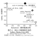

（源：`out/figs/rq1_methods_scatter.svg`；图题与注已随图。）

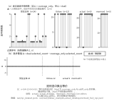

（源：`out/figs/rq1_equiv50.svg`；图题与注已随图。）

**统计检验**（来源 `out/rq1_stats.md`）：ours bootstrap 95% CI——Reduction 0.625 (0.493–0.75)、Safety 1 (1–1)、Precision 1 (1–1)。

**表 5-2　ours 与基线的统计检验**

| 对比 | 指标 | Wilcoxon p | Cliff δ | McNemar（安全）|
|---|---|---|---|---|
| ours vs retest_all | Reduction | 0.0001 | 0.7917 | b=0,c=0,χ²=0 |
| ours vs random_k | Safety | 0.0003 | 0.7083 | b=17,c=0,χ²=15.06 |
| ours vs static_heuristic | Reduction | 0.0143 | −0.5451 | — |
| ours vs static_heuristic | Safety | 0.0143 | 0.3333 | b=8,c=0,χ²=6.125 |

**信号消融**：覆盖映射是安全主干（coverage_only/dual 在 24/24 过渡上安全）；UI 信号仅在 2/24 个过渡触发选择（受控主体 c08、c20 各命中 1 条，均为 locator 改名类），单用 Safety 仅 0.083（漏选逻辑/路由/断言）。`uidiff_only` 只作为并集中保证召回的那一半（`dual = coverage_only ∪ uidiff_only`），在本数据集上未产生边际增益：它在 50 个过渡上命中的用例（受控 c08/c20 各 1 条、actual_desktop 第 9 个过渡 32 条）全部已被覆盖臂包含，dual 计数始终等于 coverage 计数。其触发条件很窄——变更文件未被任何用例覆盖（覆盖盲区），且测试代码以引号字面量锚定了变更的 UI 字符串；两者不同时成立时 uidiff 为 0。可核对的是 tldraw 的 3 个 `affected=0` 过渡（第 2、4、9 条）：这 3 条在插桩范围内的改动只有测试文件（`packages/tldraw/src/test/*.test.ts(x)`），其中两条的源码改动落在插桩范围之外（`packages/editor`），既无可覆盖的执行路径、也无可锚定的 UI 字面量，uidiff 同样为 0。另有 i18n 迁移过渡（tldraw 第 12 条）给出字面量锚定的边界：文本被 `msg('…')` / `${…}` 模板化后只有 `Learn more` 这类完整字面量能被抽取，模板表达式本身无法作为锚值。UI 信号的可测量增益只出现在覆盖粒度过粗的单组件应用——见第 5.5 节 C1 动态实测（uidiff Precision 1.0 vs 纯覆盖 0.333），那是**精度证据，不是本 RQ1 的缩减增益**。

**召回保证（非循环 oracle）**：结果差异 oracle 下，有 observed-affected 的过渡 4 个，`SafetyEmp(ours)=1.0`、`SafetyEmp(coverage_only)=1.0`、0 漏选（`safety_misses.json` 为空）。变异压力测试：4 文件 mean SafetyEmp=1.0、all_safe=true、0 漏选，且 `home.js` 变异产生非空有效样本并被覆盖臂命中（来源 `out/safety_mutation.json`）。

**副作用 live 证据**（来源 `out/sideeffect.json`）：当 `Δ={src/dashboard.js}` 时，生产者 A 写共享后端状态、消费者 B 读该状态并断言计数为 1。

**表 5-3　共享状态副作用下 naive 覆盖选择与状态闭包的保真度对比**

| | coverage_only（naive） | state_closed（本方法）|
|---|---|---|
| 选择集 | 仅 B（漏掉生产者 A）| B + A |
| B 子集重跑判定 | **fail**（visits=0）| pass |
| 与全量套件判定(pass)保真度 | **不保真（翻转）** | 保真 |

结论：共享状态副作用下 naive 文件级覆盖 RTS 不安全；状态依赖闭包因 `A ⤳ B` 将 A 纳回，恢复判定保真度（端到端验证命题 2）。

**RQ1 真实项目多 commit replay（已接入 2 个真实 Playwright 项目）**：

借助通用 **CDP 覆盖注入**（`page.coverage` V8 覆盖，透明改写测试导入、不改业务代码、无需预插桩，实现见 §4.2），在两个真实开源项目的连续 commit 上回放、按 git diff 选择用例。两项目分别代表"模块化 monorepo"与"单页强耦合 SPA"两类典型结构。

**表 5-4　真实项目 RQ1 多 commit replay 结果**

| 项目 | 栈 / 起服务 | 稳定过渡 | 方法 | Reduction | Safety | Precision |
|---|---|---|---|---|---|---|
| actual-budget（desktop-client）| React + Vite dev | 9 | coverage_only / dual | 0.111 | **1.0** | **1.0** |
| | | | uidiff_only | 0.895 | 0.216 | **1.0** |
| mermaid-live-editor | SvelteKit + Vite dev | 5 | coverage_only / dual | 0.0 | **1.0** | **1.0** |
| | | | uidiff_only | 1.0 | 0.0 | **1.0** |

**函数级归因在真实项目上的逐过渡回放（n=9）**：另一轮实验在每个过渡上重跑函数级 CDP 覆盖（V_old 与 V_new 各一次全量套件）并执行四层归因，结果如右列：coverage_only 的 Reduction 为 **0.111**（34 条用例几乎全选），graph-selection 为 **0.742**——与受控主体 0.625→0.889 同一方向。`Safety` 在覆盖 oracle 口径下由 1.0 降到 **0.369**，但这是**同源自证**的结果（与 §5.1.1 相同）：9 个过渡中 2 个 graph 选 0 条而覆盖选 34 条，逐条核查确认**graph 正确**——改动分别是 `HistoricalAutomationReadOnly` 的一句文案与 `SelectLinkedAccountsModal` 的一个 prop 默认值，两个组件都**从未被 e2e 渲染**；文件级之所以"覆盖"，是 Vite 在应用启动时 import 并执行了模块级代码（**import-即-覆盖的假阳性**），两过渡的 `A_obs` 均为空。非循环 oracle 的判别力仍然有限：9 个过渡中仅 1 个产生结果差异，该过渡上两法 `SafetyEmp` 均为 1.0。复现：`node experiments/real/run_rq1_real_graph.mjs <adapter.json> 9`。

跨项目合计 n=14：dual 在两项目上均 **Safety=1.0、Precision_cov=1.0**（覆盖口径；bootstrap 95% CI 均为 [1,1]；非循环 `A_obs` 在两项目上均极小，精度不可测）；coverage_only 与 dual 逐过渡选中集合相同（属上文 50 个过渡逐例等价的一部分，Wilcoxon dual vs coverage_only 三指标 p=1）。来源 `out/real/{actual_desktop,mermaid_live}_rq1.json`、`out/real/real_rq1_stats.md`。

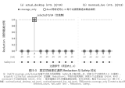

（源：`out/figs/rq1_real_transitions.svg`；图题与注已随图。逐例数值见 `out/real/{actual_desktop,mermaid_live}_rq1.jsonl`。）

两点诚实观察，与受控主体相互印证，量化了方法的适用边界：

- **覆盖选择的缩减取决于"覆盖耦合度"**：actual 的多数过渡改动核心/共享文件，6 个 spec 的 34 个用例几乎全部触及→Reduction 仅 0.111；mermaid 为单页编辑器，核心组件被几乎每个用例加载→Reduction≈0。这是覆盖型 RTS 在强耦合应用上的固有局限，而非本方法特有；Safety 始终为 1.0。
- **UI 信号臂是稀疏触发的召回兜底，不是缩减增益来源**：前向开发中 testId/可见文本大多稳定（新功能多为 ADD，不触发 REMOVE/MODIFY），故 uidiff 自然较少选中。actual 9 个过渡中仅 commit `19cea1a`（"schedule 金额改用 ± 符号"，改动 testId `date`）触发，经页面对象导入闭包映射到 32 个用例，**uidiff_only Precision_cov=1.0**（覆盖口径，选中皆受影响）；但这 32 条全部已在覆盖臂内，dual 仍为 34 条，最终选中集合未变。§5.5 C1 在单组件应用上给出 uidiff 把精度从覆盖级 0.333 提升到 1.0 的动态证据，那是**精度**而非缩减，且发生在覆盖粒度过粗的场景；在本 RQ1 的 50 个过渡上，UI 信号未带来任何集合变化。

> 工程化要点（使 uidiff 能在真实工程激活，见 §3.3）：抽取器纳入携带定位锚点属性的设计系统组件（`<Button>/<TapField>` 等，非仅原生标签）；信号→测试匹配要求引号字面量（消除 `date`→`update` 误匹配）并对 spec 做本地导入闭包展开（覆盖 Page Object 间接层）。离线扫描器 `scan_ui.mjs` 可在不安装、不跑测试的前提下定位可激活窗口。

### 5.2 RQ2：生成——diff 约束的相关性

**缺口检测（graph）**：生成的目标缺口由 §3.2 的 test-code graph 提供——`detectGaps`（`select.mjs`）反向找"无 `executes`/`navigates` 入边"的函数/路由，替代文件级 `coverageGap`（"整个文件零覆盖"）。受控主体上，这能抓出文件级漏掉的**未使用函数**缺口（`util.js::discount/taxCents`——util.js 被 cart/orders 覆盖，故不算"零覆盖文件"，文件级方法漏掉），并给每个缺口提供 route/component 上下文供生成 prompt 使用（见 `out/rq2_rq3_graph.md`）。

**语义有效性度量（方法）**：人工双标注成本高且带主观性，本文以**两个客观自动指标**作为语义有效性的主度量；人工 Cohen's κ 不用于替代自动评测，而用于对自动判据做**中等规模人工盲评一致性验证**：

- **变异杀伤（mutation kill）**：向缺口新增源码注入可被测试观察到的变异（重命名各 `data-testid`、对结果文本整段替换为无共享子串的新文本、对 `label` 与 `aria-label` 按控件整链替换、删除结果容器、反转条件逻辑），重跑该生成用例。若其由通过转为失败即"杀掉"该变异，说明用例确实在验证新行为；恒真/仅占位的断言一个也杀不掉。指标为每条用例 killed/injected 的均值。文本类算子优先改**结果文本**（状态/计数/列表项/结果段落/结果串），属性类算子优先改**可访问名与 `label`** 的整条命名链，而不是改写标题或追加后缀——后者会被子串匹配吸收。
- **版本差分敏感性（change sensitivity）**：同一生成用例在 V_new（缺口提交，新功能存在）通过、在 V_old（前一提交，新功能尚不存在）失败，则判定其对该变更敏感——这排除了与变更无关的"哪个版本都能过"的弱用例。
- **自动语义有效率** = 可执行 ∧ 触达变更文件（change-relevant） ∧ 版本敏感 ∧ 杀掉≥1 个注入变异（完全客观、无需人工）。其中 change-relevant 条件是在表 5-5/5-5b/5-5c 的结果全部落盘之后**补入并固化**的判据定义（补入时点见本节末段），不是原次执行的输入；它要求用例在其覆盖集合中包含该缺口的变更文件，避免"可执行但根本没走到新代码"的用例被计为语义有效。

**表 5-5　RQ2 双臂自动语义指标（受控主体，n=3，真实 LLM，provider=DeepSeek）**

| 臂 | n | executable-rate | change-relevant-rate | 变异杀伤(均值) | 版本敏感率 | 自动语义有效率 |
|---|---|---|---|---|---|---|
| diff（约束）| 3 | **1.0** | **1.0** | **0.6667** | **1.0** | **1.0** |
| nodiff（基线）| 3 | 0.0 | 0.0 | 0.0 | 0.0 | 0.0 |

来源：`out/rq2_results.md`。为避免 LLM 输出格式影响执行，生成端对 Markdown 代码围栏做清洗，并统一将 `@playwright/test` 导入改写为项目覆盖采集 fixture `./fixtures`；真实 provider 请求失败或返回空 completion 时直接报错，禁止静默 fallback。结果显示，diff 约束臂在 3 个新增缺口上全部可执行、全部触达变更文件、全部对版本差异敏感，且均杀掉至少 1 个注入变异；无 diff 基线 0/3 可执行，且 0/3 触达变更文件。

**表 5-5b　RQ2 扩样补充（b）：v2 算子重跑，n=8（x01–x05 + 主实验 c03/c13/c19，同一批 16 条用例原文）**

| 臂 | n | executable-rate | change-relevant-rate | 变异杀伤(均值) | 版本敏感率 | 自动语义有效率 |
|---|---|---|---|---|---|---|
| diff（约束，v2）| 8 | 1.0 | 1.0 | **0.7792** | 1.0 | 1.0 |
| nodiff（基线，v2）| 8 | 0.125 | 0.0 | 0.0 | 0.0 | 0.0 |

**表 5-5c　RQ2 扩样补充（c）：缺口扩至 n=10（x01–x05 + y01–y05，diff 臂 v2 算子）**

| 臂 | n | executable-rate | change-relevant-rate | 变异杀伤(均值) | 版本敏感率 | 自动语义有效率 |
|---|---|---|---|---|---|---|
| diff（约束，v2）| 10 | **1.0** | **1.0** | **0.8438** | **1.0** | **1.0** |
| nodiff（基线，v2）| 10 | 0.2 | 0.0 | 0.0 | 0.0 | 0.0 |

**三套口径不可比（算子版本与缺口集合不同）：n=3（表 5-5）为主表；5-5b/5-5c 只用于隔离算子实现改动与扩大样本的影响、不作优劣比较，三表数值不得合并、求和或据上升趋势得出"主结果被取代"的结论。** 具体而言：表 5-5 为受控主历史 c03/c13/c19（n=3，冻结不动）；5-5b 为同一批用例换用 v2 算子后的 8 缺口结果（用于隔离算子实现改动的影响）；5-5c 为新增 y01–y05 后与 x01–x05 合并的 10 缺口结果（新增缺口在运行前已按预注册清单登记，`out/new10_20261108/manifest_expansion_v2.json`）。三表脚注口径相同（可执行 ∧ change-relevant ∧ 版本敏感 ∧ 杀伤≥1）。**需明确披露：change-relevant 条件是在三张表的结果全部落盘之后补入的判据定义，不改变任何已落盘格值**——diff 臂 3/3、8/8、10/10 的用例覆盖集合均包含对应缺口变更文件，nodiff 臂触达率为 0，与补入前的格值完全一致，故三表数值无需重算；补入只把口径固化下来，供后续复跑与审计使用。5-5c 的 diff 臂变异杀伤均值提升到 0.8438，仍有个别未杀伤点（如 y05 的周期 label/role 未被用例使用），属用例信号覆盖问题而非算子失效。来源：`out/new5_v2_20261108/RQ2_NEW5_V2_REPORT.md`、`out/new10_20261108/RQ2_NEW10_REPORT.md`。为了保证增量可比，5-5b/5-5c 均未重新调用 LLM，5-5b 复用阶段三 16 条用例原文；5-5c 的 y01–y05 为真实 DeepSeek 调用生成（未固定 temperature，spec 存在重跑波动，数值对应落盘文本）。三套口径的指标对比见图 5-4，逐缺口与算子类别的杀伤分布见图 5-5。

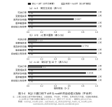

（源：`out/rq2_results.json`、`out/new5_v2_20261108/rq2_new5_v2_results.json`、`out/new10_20261108/rq2_new10_combined.json`；图题与注已随图。三套口径分别为 n=3 / n=8 / n=10，对应表 5-5 / 5-5b / 5-5c，不合并、不求和。）

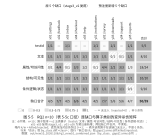

（源：`out/new10_20261108/rq2_new10_combined.json` 的 `gaps[].arms.diff` 与 `by_class`；图题与注已随图。仅 n=10 口径，不与 n=3、n=8 两批合并。）

需要强调，自动语义有效率是一个**操作化代理**，不是语义有效性的金标准：可执行率可能受环境与时序影响；版本敏感可能由与变更无关的加载差异造成；变异杀伤也只覆盖有限的注入算子。因此，本文用 30 条真实项目样本的人工盲评对自动判据做**构念效度校准**，而不是重复执行检查——盲评回答“自动判据和人的语义判断是否一致、在哪些类型上分歧”，κ 反映协议 B 预标注与人工盲评的一致性，不是人际 κ。复核披露：受控主体 c03/nodiff 一格的原有记录与冻结用例的实际执行结果不符（记录为可执行、杀伤 2/3、版本敏感，实际在 V_new 与 V_old 上均为 strict-mode 失败且覆盖率不含缺口文件），已在钉住 Playwright 1.61.0 + Chromium 1228 的环境下重跑并更正该格；同一复核中其余五个受控执行格（c03/diff、c13/diff、c13/nodiff、c19/diff、c19/nodiff）逐格复现，取证见 `diffe2e/experiments/out/repro_c03_20261108/REPRO_C03_FORENSICS.md`。[^c03]

**缺口样本的有效性复核（重要）**：事后用 test-code graph 的缺口检测复核上述 30 条样本，发现其中 **12/14 个"缺口"文件其实已被既有测试覆盖**（actual-budget 的 62 条 E2E 覆盖了 24 个变更 app 文件中的 20 个），即这些样本生成的是"为新 UI 写测试"，而该 UI 本就有测试——**生成器在回答一个非缺口问题**。按"文件确实无测试覆盖"重新筛选后，actual-budget 的 9 个过渡只剩 **4 个**真实缺口文件，其中 1 个具备可生成的 UI 新增信号。因此上述 0/30 应读作**样本构造效度**问题（缺口未被验证），而不仅是生成能力问题；这也是后续把 `detectGaps` 接入生成流程（RQ2 缺口检测改为函数/路由级）的直接动因。针对上述两项缺陷，另做一轮**生成 prompt 硬化**（在真实项目 13 个上下文上对比）：要求"给定 testId 必须用 `page.getByTestId(...)`、禁止 `page.locator('裸名')`、禁止对 body 做空可见性断言、优先 `getByRole`/`getByText`"。结果：使用真实角色/文本定位器的样本由 6/14 升至 **9/13**，裸名 `locator()` 由 11/14 降至 **6/13**，body 空断言由 4/14 降至 **3/13**——**方向正确但未根除**，说明 prompt 只能缓解"写法"问题，不能解决"缺口是否可测"。在该唯一可生成的真实缺口上另试了**有界执行反馈**（生成→运行→回传 Playwright 报错→重写，至多 3 轮）：首轮与第 3 轮均未通过（`pass@1=false`、`pass@3=false`）——该缺口是 CodeMirror 语言配置文件，不构成可导航的 UI 页面，说明"真实缺口"未必"可测"，单点样本仅作机制验证、不作统计结论。

为验证自动语义判据与人工判断的方向是否一致，本文从两个真实项目（actual-budget、mermaid-live-editor）中构建 30 条人工复核样本（`out/rq2_real_to_annotate.csv` + `out/rq2_real_to_annotate_unblind.json`），diff/nodiff 各 15 条。该 30 条的协议 B 正式列（三次重复多数票）为 **diff 臂 2/15、nodiff 臂 0/15**（y 为 `rq2_023`、`rq2_029`，均在 diff 臂），绝对水平远低于自动指标。该 30 条的三次重复中 29 条标签完全一致、1 条为 2/3（`rq2_023`）、无 1/3。作者盲评已完成并按 §5.6 合并：**人工第二列 30/30 均判 n**；两列不一致仅 2 条（`rq2_023`、`rq2_029`），经独立第三人先盲后明仲裁后 `final` 均为 n，即**仲裁后人工语义有效率为 0/30**（diff 0/15、nodiff 0/15）。一致性为 **Po=0.9333、Pe=0.9333、κ=0、Gwet's AC1=0.929**：κ=0 系人工列为常量导致的退化（患病率悖论），AC1=0.929 则给出偏斜分布下有区分度的一致度（§5.6），与 93.3% 的原始一致率并存，须与 2×2 混淆矩阵（y→n 2 条、n→n 28 条）同报。据此，自动判据与人工判据的关系应读作：自动语义有效率 1.0 只证明生成测试可执行、版本敏感且能杀死注入变异，**不证明**其通过人工严格四问（有真实步骤、真实断言、步骤落在变更交互上、断言验证变更效果）的语义有效性；协议 B 预标注（2/30）与人工盲评（0/30）都只能作为**外部效度限定**，不得写成“复现 1.0”。

针对表 5-5c 的扩样 diff 臂，另生成了**独立的人工盲评包**（`out/new10_20261108/annotation_packet/`）：case_id 使用独立命名空间 `nb001`–`nb005`，与主实验包的编号和哈希清单互不复用；包内附一页标注说明，沿用协议 B（第一列为三次多数票；本包只收第二标注列 `annotator2_yn`，不一致交第三人仲裁填 `final`）。遮蔽与泄漏复核已通过（`LEAKAGE_CHECK.json`，PASS）：包内只保留变更文件、路由、源码 diff 与生成 spec，不含主实验或任何批次的具体数值、不含分布统计，也不引用解盲键；解盲键存放在包外 `new10_packet_unblind.json`。该包与主实验盲评包是两份独立交付物，不合并统计；定稿中该包仅作**自动判据的独立归档材料**，不纳入人工一致性统计。

[^c03]: c03/nodiff 属**记录性异常**，不是方法或算子失效：原始记录与冻结用例的实际执行不符，修正只涉及该单格，diff 臂与主表其余五格逐格复现不变。修正前后的原始产物、报告同步与可校验哈希见 `diffe2e/experiments/out/repro_c03_20261108/REPRO_C03_FORENSICS.md`、`SHA256SUMS_MAIN_after_c03_fix.txt` 与 `FREEZE_RECORD.md` §8；主表 n=3 的其余数值不因本脚注改动。

### 5.3 RQ3：闭环支撑与修复边界

RQ3 的目的不是证明本文已经解决真实 Web 测试修复，而是回答两个支撑性问题：第一，轻量修复是否能让受控场景中的 selected stale tests 重新进入 targeted set；第二，真实 locator 断裂在"只给旧测试 + 应用 diff"的无泄漏设定下到底有多难。前者服务于选择+生成闭环的可用性，后者用于限定本文方法边界。

**断点诊断（graph）**：分诊不再用 `sigMap`/`segMap` 两套规则，而用 test-code graph 的 `asserts` 边（§3.2）——解析测试源码的定位器/断言，得到 test → ui 节点边；一个失败测试的 `asserts` 边指向被 diff 改动的 ui 节点，即断点所在，且旧→新语义锚（Semantic UI Diff）就是修复锚。受控主体 4 个断裂过渡全部正确诊断（c08/c20 为定位器断裂、c15/c21 为断言断裂），见 `out/rq2_rq3_graph.md`。

**受控主体（n=4，provider=deepseek）**：规则臂修复成功率 0.75（3/4），LLM 臂修复成功率 1.0（4/4）；mean TargetedSetUsability（按规则修复后可进入 targeted set 的保守口径）：before 0.0 → after 0.75。该结果说明轻量修复足以支撑受控闭环，但不外推为真实项目修复能力。

**表 5-6　RQ3 受控主体修复结果（n=4）**

| tag | type | target | staleness | rule 修复 | LLM 修复 | usability_before | usability_after |
|---|---|---|---|---|---|---|---|
| c08 | locator_break | cart.spec.ts | STRUCTURAL_ONLY | true | true | 0 | 1 |
| c15 | assertion_break | login.spec.ts | EXPECTATION_CHANGE | true | true | 0 | 1 |
| c20 | locator_break | search.spec.ts | STRUCTURAL_ONLY | true | true | 0 | 1 |
| c21 | assertion_break | orders.spec.ts | SUSPECTED_REGRESSION | false | true | 0 | 0 |

来源：`out/rq3_results.md`。过时三分类正确区分定位失效（STRUCTURAL_ONLY，语义定位重写）与期望变化（EXPECTATION_CHANGE，断言更新）；c21 被保守分为 SUSPECTED_REGRESSION，规则臂不改写，因此不进入 targeted set，LLM 臂可生成通过补丁但需结合人工/业务语义判断是否应采纳。

**ReproBreak 真实数据（离线 / CSV ground truth）**，来源 `realproj/results/reprobreak.md`：
- **E1 数据刻画**：9604 条真实结构性 locator 断裂对，Playwright 4867（50.7%）/ Cypress 4737（49.3%）。
- **E2 Semantic UI Diff 可达性**：1172/9604 = 12.2% 为 testId/text/role-name/href 语义锚值替换（本方法 UI 信号直接可定位）；其余为 CSS id/class 改名、结构重排、策略切换（需 DOM 拓扑或 LLM）。分框架：Playwright 17.4% vs Cypress 6.9%（Playwright 语义定位天然更可修）。
- **E3 确定性改写器精确匹配（已知 oracle 信号，上界）**：在可达的 578 条上精确重建开发者修复 574/578 = 99.3%。该指标隔离"改写机制在真实语法上的正确性"，假定语义信号已知。

> 诚实定位：E3 是上界（给定 oracle 信号）；端到端"diff→信号→修复"的信号检测精度需各 commit 源码 + 执行验证。

**RQ3 ReproBreak 端到端（无泄漏，真实逐 commit 源码）**，来源 `realproj/results/reprobreak_e2e.md`：

从 ReproBreak SQLite 导出 **449 条执行验证断裂**（4 个真实开源项目：ghiscoding/angular-slickgrid、tryghost/koenig、nasa/openmct、microsoft/playwright），逐条按其 commit 克隆 AUT、取旧（断裂）测试与应用源码 old/new diff，端到端修复并与 ground-truth `new_locator` 做归一化 exact-match。无泄漏护栏（旧测试须含 `old_locator` 且不含答案）跳过 35 条，进入评估 n=414。

**表 5-7　ReproBreak 端到端无泄漏修复结果**

| 臂 | n | exact-match 修复率 | 备注 |
|---|---|---|---|
| 规则（rule）| 414 | 3.38%（14/414）| 仅用旧测试 + 应用 diff（有 app 信号子集 14/393=3.56%）|
| LLM（DeepSeek）| 414 | 7.25%（30/414）| 同上输入 + LLM 推理；LLM 调用错误 0 |

> **关键对比**：E3 离线「已知 oracle 信号」改写器上界为 99.3%，而本节端到端「从应用 diff 自行还原 old→new 信号」的规则臂仅 **3.38%**，DeepSeek LLM 臂提升至 **7.25%**。LLM 在 microsoft/playwright 子集上增益明显（16/45），但整体 exact-match 仍远低于已知信号上界。因此，ReproBreak 在本文中应被解读为**真实修复难度和边界的量化**：当前轻量修复模块可支撑闭环，但还不能作为真实 locator 修复的强结果；后续需要 DOM/trace 候选元素、运行时对齐和执行验证式语义等价判定。四级口径的关系见图 5-6。

> **非确定性说明**：LLM 臂不设 `temperature`，修复率在重跑间有波动——本文重跑得 30/414=7.25%，早期批次为 23/414=5.56%；规则臂确定，恒为 14/414=3.38%。两者量级一致（个位数百分比），结论"真实 locator 修复仍难、远低于已知信号上界"不因波动改变。

**改进试验：候选定位器 + Page Object 闭包 + 双口径**（`realproj/results/reprobreak_e2e_v2.md`）。为检验"上下文不足"这一解释是否成立，另做一轮改进：修复 prompt 注入 (i) 从 V_new 应用源码抽取的**候选定位器**（testId/aria/可见文本/id/class，≤60 个）、(ii) 被测 spec 的 **Page Object 导入闭包**（1–2 层本地 import），并要求只输出一行定位器。结果（n=414，同一池）：

**表 5-7a　改进试验的 exact-match 对比**

| 臂 | 旧批 exact-match | 改进版 exact-match |
|---|---|---|
| 规则 | 3.38% | 3.38% |
| LLM | 7.25% | **6.52%** |

**在全池上候选与 POM 闭包没有带来提升**——它们对占池 **59%** 的 CSS class / XPath 断裂（`ghiscoding/angular-slickgrid`，245 条）原理上无效。**新增语义等价口径**（`getByTestId('x')` ≡ `[data-testid="x"]`）后，在"答案锚点具有区分度（distinctive：testId/文本/label，且修复前不含等价形式）"的 **90 条子集**上：

**表 5-7b　语义等价口径（子集 n=90）**

| 指标（子集 n=90） | 规则臂 | LLM 臂 |
|---|---|---|
| exact-match | 13.33% | 26.67% |
| **语义等价** | **14.44%** | **33.33%** |

即 exact-match 确实误杀了部分正确修复（LLM 臂 26.67%→33.33%，相对 +25%），增益集中在语义锚点为主的项目（koenig 8→14）。**结论**：修复难度的瓶颈不在"上下文不足"，而在 **ReproBreak 池的构成**——只有约 28%（115/414）的断裂具备语义锚点替换空间，其余是 CSS class/XPath 改名与结构重排，需 DOM 拓扑或执行验证才能修。该结果独立复现了 E2 的 12.2% 可达率。

**模型能力对照：pro vs flash（同子集 n=90）**。为检验"批量用 flash 导致修复率偏低"这一替代解释，本文在**同一** distinctive 语义子集（`sem_applicable && !pre_had_equiv`，n=90）上用 `deepseek-v4-pro` 重跑同一 prompt、同一"只输出一行定位器"约束与同一判据（`RB_SUBSET=semantic`、并发 6；产物 `realproj/results/reprobreak_e2e_pro90.json`，配对对照 `reprobreak_pro90_compare.md`）：

**表 5-7c　pro vs flash 同子集对照（n=90）**

| 指标（n=90） | flash | pro | 差值 |
|---|---:|---:|---:|
| exact-match | 26.67%（24/90） | 23.33%（21/90） | −3.33 pp |
| 语义等价 | 33.33%（30/90） | 30.00%（27/90） | −3.33 pp |

配对 McNemar（两指标相同）：b=4（flash 对、pro 错）、c=1（flash 错、pro 对）、exact p=0.375；两模型调用错误均为 0；规则臂在两模型下相同（12/90 exact、13/90 语义，确定性）。**结论**：把批量修复模型从 flash 换成 pro，没有提升（反而低 3.33 pp，统计上不显著），远不足以解释全池 7.25% 与已知信号上界 99.3% 之间的差距。因此"模型降级"不是低修复率的主因，瓶颈仍是池构成（59% CSS class/XPath 无锚点）与从应用 diff 自行还原信号的难度；推理型模型在"单行定位器输出"这类窄任务上也没有转化为更高修复率。

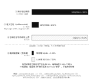

（源：`realproj/results/reprobreak.json`（①②③）与 `realproj/results/reprobreak_e2e.json`（④）；图题与注已随图。四级分母不同：9604 / 9604 / 578 / 414，④ 与 ③ 为并列口径而非包含关系。）

**分仓构成与可读边界**：上述 414 条池的仓库构成与两臂命中可直接由 `realproj/results/reprobreak_e2e.json` 的 `rows[].repo / .rule / .llm` 统计（同一组数字的分项目表见 `realproj/results/reprobreak_e2e.md`）：ghiscoding/angular-slickgrid 245 条（59.2%）、tryghost/koenig 78 条（18.8%）、nasa/openmct 46 条（11.1%）、microsoft/playwright 45 条（10.9%）；对应规则臂命中 0/7/6/1，LLM 臂命中 4/3/7/16。LLM 臂 30 条命中中有 16 条（53.3%）来自 microsoft/playwright（16/45=35.6%），而池量最大的 ghiscoding/angular-slickgrid 两臂合计仅 4/245=1.63%（规则 0、LLM 4）。因此总体 7.25% 是四个仓库按池量加权后的混合值：增益主要来自池量最小的一个仓（45 条，占池 10.9%），在占池 59.2% 的最大仓上接近为零。该总体百分比不宜读作各仓的普适水平；本文只陈述落盘数据支持的构成事实，不对"方法在某类仓库更有效"作归因判断。

**抽样设计带来的同类偏斜**：同一 414 条池上的过时类型人工复核按仓库分层等额抽取（每仓 10 条、共 40 条；`experiments/out/rq3_reprobreak_to_annotate.csv` 的 `repo` 列各 10 条），对应抽样比从 4.1%（10/245）到 22.2%（10/45），小仓约为大仓的 5.4 倍。该分层只作用于仓库、不作用于过时类型：类型分布（表 5-8）是观测结果而非抽样约束。因此这 40 条不能读作 414 条池的仓库比例，也不能读作各仓的普适水平。图 5-7 的（a）（b）两面板并列呈现池量、等额抽样与两臂命中，图注已声明不用于跨仓外推（数据为 414 条全池，非 40 条复核样本）。

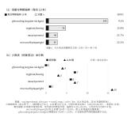

（源：`realproj/results/reprobreak_e2e.json` 的 `rows[].repo / .rule / .llm`；图题与注已随图。414 条全池口径，与 40 条人工复核样本不是同一分母。）

**过时类型人工复核（40 条盲评样本）**：从上述 414 条无泄漏评估样本中抽取 40 条，按协议 B 盲评材料、固定模型（`deepseek-v4-flash`，`temperature=0`）重复 3 次并取多数票，得到正式预标注列（LLM 辅助预标注，附逐条理由）。正式列 40/40 有效：**STRUCTURAL_ONLY=40、EXPECTATION_CHANGE=0、SUSPECTED_REGRESSION=0**（表 5-8）。其中 39 条可判为结构性；第 40 条 `rb033` 经作者逐条复核确认为 `EXPECTATION_CHANGE`——协议要求遮蔽定位路径，而该条的业务语义恰好只由被遮蔽的属性承载（旧断言定位 markdown 卡，新断言定位 codeblock 卡），遮蔽后新旧两侧只剩“路径已变更”的标记，预标注只能判为 `STRUCTURAL_ONLY`。这属**协议固有边界**，不是判据模糊：该类基准存在一类无法靠遮蔽后的结构信号判定的断裂。RQ3 的 40 条三次重复全部一致（40/40 为 3/3，无 2/3 或 1/3）。样本构成以测试 API 迁移与格式变化为主（如 `page.$`→`page.locator`、style 字符串空格、`waitForSelector`→`locator`），并非都由应用行为变化引起，因此不应把该分布解读为真实项目中三类过时的先验比例（协议 B 分布见图 5-8）。

**表 5-8　RQ3 过时类型人工复核样本与协议 B 预标注分布（样本 n=40，三次多数票）**

| 过时类型 | 协议 B 预标注计数（正式列，三次多数票） | 说明 |
|---|---:|---|
| STRUCTURAL_ONLY | 40 | 意图不变，仅 locator / DOM / 文案锚点 / 测试 API 迁移或测试自身严格化 |
| EXPECTATION_CHANGE | 0 | 断言目标或业务预期发生实质变化 |
| SUSPECTED_REGRESSION | 0 | 无法排除新版本真实回归，保守归类 |
| 调用失败（未计入） | 0 | 无调用失败 |

> **作者复核（不计入表内计数）**：`rb033` 应为 `EXPECTATION_CHANGE`。上表保留协议 B 的原始输出 40/0/0，不改为 39/1/0；作者盲评 40/40 判 STRUCTURAL_ONLY，与表内计数一致（Po=1.0，§5.6）；`rb033` 经第三人先盲后明仲裁维持作者复核结论；其偏差的遮蔽成因单列讨论于 §5.3 与 §5.7。

需要强调三点限制：(i) ReproBreak 由 locator 断裂构造，自动分诊标签 `model_label` 恒为 STRUCTURAL_ONLY，模型-人工 κ 不具区分度，只能作描述性准确率报告；(ii) 40 条的三次重复全部一致（40/40 为 3/3），正式列取多数票并同时报告 3/3、2/3、1/3 与不稳定条目清单；仍需同时报告样本构成与混淆矩阵，避免把“高一致率”误读为“强区分能力”；(iii) `rb033` 属协议固有边界：该类断裂的业务语义只由被遮蔽的属性承载，遮蔽后结构信号不足以判定，故预标注只能判 `STRUCTURAL_ONLY`；作者复核确认为 `EXPECTATION_CHANGE`，本文单列披露，不因此放松通用遮蔽规则。作者盲评已完成并按 §5.6 合并：人工第二列 40/40 均为 STRUCTURAL_ONLY，与协议 B 正式列完全一致（Po=1.0、混淆矩阵仅 SO/SO=40、逐条分歧为空），按既定口径不报 κ（常量列 `Pe` 退化）。`rb033` 在人工列中同样标为 STRUCTURAL_ONLY；其作者复核结论经独立第三人先盲后明仲裁维持 EXPECTATION_CHANGE，仍单列披露、不回改表内计数。


（源：`out/annotator1_masked.json`（40 条协议 B 三轮多数票）与表 5-8；图题与注已随图。表中保留协议原样 40/0/0，`rb033` 的作者复核结论单列，不回改计数。）

#### 5.3.1 扩展批次（`rbx001`–`rbx040`）：独立样本上的分布稳定性

为检验"主实验 40 条几乎全为结构性"是否只是该批样本的偶然，另取一批**独立样本**做真实分诊，不与主实验合并：

- **抽样**：仍为同样四个仓库（ghiscoding/angular-slickgrid、microsoft/playwright、nasa/openmct、tryghost/koenig），按仓库内 hash 排序取第 11–20 条，每仓 10 条、共 40 条，case id `rbx001`–`rbx040`；与主实验 40 条（每仓第 1–10 条）**零重叠**。
- **真实分诊结果**：40/40 有效（45 次调用，失败 0），**STRUCTURAL_ONLY=38、SUSPECTED_REGRESSION=2**。两条 `SUSPECTED_REGRESSION` 均落在 `microsoft/playwright`；分仓结构性计数为 10 / 8 / 10 / 10。
- **材料与隔离**：本批有独立盲评包 `annotation_packet_expansion`（6 个文件，独立 `SHA256SUMS`），遮蔽泄漏复核 40/40 PASS。人工第二列已于 2026-11-21 回收：40/40 填写，**STRUCTURAL_ONLY=39、EXPECTATION_CHANGE=1**（唯一 EC 为 `rbx031`，tryghost/koenig）。与真实分诊列的一致性为 **n=40、Po=0.9250、Pe=0.9263、κ=-0.0169、Gwet's AC1=0.922**——两列均高度偏斜（SO 占 38–39/40），κ 无判别力，AC1=0.922 在偏斜分布下仍反映实质一致（§5.6），与混淆矩阵同报（SO→SO 37、SO→EC 1、SR→SO 2）。两列不一致的 3 条（`rbx016`、`rbx020`、`rbx031`）经独立第三人先盲后明仲裁（盲判与明判一致），`final` 分别为 STRUCTURAL_ONLY、SUSPECTED_REGRESSION、EXPECTATION_CHANGE；**仲裁后 final 分布为 SO=38、SR=1、EC=1**，两列对 final 的一致率分别为 0.9500（分诊）与 0.9750（人工）。值得注意的是两列的少数类不重叠（分诊侧 2 条 SR 人工均判 SO，人工侧唯一 EC 分诊判 SO），说明扩展批的少数类均为对判据敏感的低置信边界样本；人工列确认"SO 为绝对主体"（39/40），与主实验人工列（40/40 SO，§5.3）方向一致。
- **统计口径**：只用于检验扩展样本上的分布稳定性，**不并入表 5-8**，不与主实验拼成 n=80 的合并分布，也不合并 κ 或 p 值。原因之一是两批的模型侧口径不同：主实验记录的是常量标签 `STRUCTURAL_ONLY`（40/40），本批是真实分诊（38/2），二者不可直接比较"模型-人工一致性"。

因此，主实验的 40/0/0 与扩展批的 38/2 分两段报告：前者是协议 B 在遮蔽条件下的预标注分布（并附 `rb033` 的作者复核），后者是相邻样本上的真实分诊分布，二者共同说明"该类基准以结构性过时为主"这一结论在独立抽样下并未翻转，但不构成统一的先验比例。

### 5.4 RQ4：成本——净收益

**受控主体执行量**：跨 24 个过渡，retest-all 共执行 144 次用例，文件级 `coverage_only` 执行 54 次（下降 62.5%），**函数级四层归因（test-code graph）仅执行 16 次（下降 88.9%，SafetyEmp 仍=1.0）**。生成/修复均按需触发（仅缺口/失效用例），额外成本与变更规模成正比。

**真实项目 NetSaving（actual-budget，62 个 e2e 测试）**：实测 `T_full=168s`、`T_run(单测试)=19.5s`（Vite webServer 启动 ~17s 是固定成本）、`T_select≈9.1s`（tree-sitter 构建 1968 文件静态图 + 选择器）。据此，三种改动的 `NetSaving = 1 − (T_select + T_run(Sel))/T_full`：

**表 5-9a　62 用例 NetSaving 成本模型测算**

| 改动 | 选择器 | 选中 | NetSaving |
|---|---|---|---|
| 加路由（d05bd03） | route-level | 0 | **94.6%** |
| 改共享常量 | value-reference | 1 | **83.0%** |
| 改共享文件 | file-level | 62 | **−5.4%**（T_select 是纯税，比 retest_all 还差） |

**口径说明（重要）**：上表三行 NetSaving 是**成本模型测算值**，不是每臂独立重复 3 次的分布统计：`T_run(Sel)` 对 0 选中取 0s、对 1 选中取实测单测 19.5s、对 62 选中取实测全量 168s，再与实测 `T_select≈9.1s` 一起代入 `NetSaving = 1 − (T_select + T_run(Sel))/T_full`。逐臂重复 3 次并报告 median/IQR 的实测是表 5-9；两者口径不同，不能混用。测算的输入、公式与逐行结果落盘在 `out/real/actual_desktop_rq4_graph.json`（`basis` 字段明确标注为 analytical values，非重复实测）。

**关于 `T_select≈9.1s` 的口径**：该值来自 tree-sitter 对 1968 个文件的全量静态建图 + 选择器计算，属**冷启动上界**；在 CI 连续提交场景下，只需重解析 diff 触及的文件（增量更新，与全量逐例一致已验证），该开销可降至亚秒级。本文按上界报告，属保守口径。两个诚实现象：**Reduction ≫ TimeReduction**（value-reference 把用例数减 62→1，但 TimeReduction 只有 88.4%——webServer 启动成本省不掉）；**SelectionTax 是真实税**（T_select 占 T_full 的 5.4%，对小改动是主要开销，但相对文件级"全选 62 还白交税"仍是净赚）。详见 `out/real/actual_desktop_rq4_graph.md`。

**RQ4 真实项目 wall-clock + NetSaving**，来源 `out/real/*_rq4.json`，每臂重复 3 次并报告 median/IQR（表 5-9）。

**表 5-9　RQ4 真实项目成本与净收益（每臂 3 次，median/IQR）**

| 项目/场景 | workers | full_count | selected_count | Reduction | T_full (median/IQR) | T_run(Sel) | T_select | TimeReduction | NetSaving | break_even | machine-minutes(full/ours) |
|---|---:|---:|---:|---:|---|---|---|---:|---:|---|---|
| cand_coverage（C1 动态，选中 1/3） | 1 | 3 | 1 | 66.7% | 1.64s (1.64-2.27) | 1.43s (1.43-1.44) | 0.12s (0.12-0.13) | 12.4% | 5.0% | true | 0.027/0.026 |
| actual_desktop（无影响过渡，空选集） | 2 | 34 | 0 | 100.0% | 110.84s (110.58-119.35) | 0.00s (0.00-0.00) | —† | 100.0% | 100.0% | true | 3.695/0.000 |

> † 该行是"空选集"场景（selected=0），`T_select` 未单独计时，故记 `—`；图选择在 actual-budget（62 用例）上的实测 `T_select≈9.1s`（冷启动全量静态建图上界，见 §5.4 口径说明）不适用于本行的 34 用例早批口径。

> 读法：`cand_coverage` 说明用例数量减少 66.7% 并不等价于 wall-clock 同比例下降，真实 TimeReduction 为 12.4%，计入 0.12s 选择开销后 NetSaving 为 5.0%，主要受浏览器启动、dev server 与单测时长不均影响；`actual_desktop` 单场景记录的是一个 selected=0 的无影响过渡，说明空选集可避免约 111s 全量执行，但不能代表该项目平均收益。进一步按 RQ1 的 9 个 actual_desktop 过渡做 batch-estimated 汇总：1 个 empty、0 个 partial、8 个 full，mean NetSaving 为 11.1%，median NetSaving 为 0，break-even rate 为 11.1%。逐条分布见图 5-9（a）：8 个全选集过渡的 NetSaving 均为 0，均值完全由 1 个空选集过渡贡献，中位数为 0。这说明真实平均收益受 full-selection 过渡比例限制，论文中应同时报告单场景收益与多过渡分布。

**LLM token/$ 非时间成本**，来源 `out/llm_cost.{json,md}`：主链路真实 LLM 实验共 424 次调用（RQ2 6 次、RQ3 受控 4 次、ReproBreak 414 次），估算约 757.8k input tokens 与 19.1k output tokens；按 DeepSeek 官方 `deepseek-v4-flash` cache-miss 输入 $0.14/M、输出 $0.28/M 计，成本约 $0.111。该表为估算，因为早期真实运行未持久化 provider usage 字段；后续运行已支持通过 `LLM_USAGE_OUT` 记录 API 返回的精确 usage。按实验拆分见图 5-9（b）。

**口径说明（补充实验单列）**：上述 424 次仅覆盖主链路。后续扩展与对照**不并入**该成本表，单独归档：§5.2 扩样 `new10` 20 次（3,768 input / 16,600 output tokens）、`expansion_20261108/gaps` 10 次（1,867 / 8,243）；协议 B 三轮预标注 210 次（`deepseek-v4-flash`，逐次 usage 未持久化）；§5.3 模型对照 90 次（`deepseek-v4-pro`，输入 162,291 / 输出 354,841 tokens，其中 reasoning 353,700，精确用量见 `realproj/results/llm_usage_pro90.jsonl`）。pro 的价目与 flash 不同，故不按 flash 费率折算进 $0.111；主链路成本表与图 5-9（b）保持原口径。

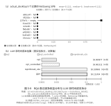

（源：`out/real/actual_desktop_rq4_batch.json` 的 `transitions_detail`（(a)）与 `out/llm_cost.json` 的 `by_experiment`／`total`（(b)）；`llm_cost.json` 不含逐过渡 NetSaving 字段，故 (a) 取自 batch 产物，(b) 的调用次数精确、tokens 与 USD 为估算。图题与注已随图。）

### 5.5 C1 闭环：Semantic UI Diff 驱动整条链

**静态（真实 JSX）**：在真实 JSX（`App.old→App.new`）上语义差分得 ADD 2 / REMOVE 1 / MODIFY 2，驱动选择（选中 paint/link/turquoise，无关用例正确排除）、生成（对新增 Crimson/Green 合成可执行用例）、修复（locator 重定向 / 断言更新 / locator 加固）。来源 `out/c1_loop.md`。

**动态（真实 React 工程 cand_coverage）**：变更 Red→Crimson + 新增 Green，实跑 e2e，结果翻转 oracle = `App.test.ts::red`。同一 oracle 下 coverage-only Precision 0.333（选 3/3），**uidiff Precision 1.0**（选 1，Reduction 0.667，Safety 1）；修复后重跑 PASS；新增 Green 按钮生成可执行=true、覆盖=true。来源 `out/c1_dynamic.md`。这是 Semantic UI Diff 在单组件应用上把选择精度从覆盖级 0.333 提升到 1.0 的动态证据；它是**精度维度、单组件场景**的证据，不能外推为 RQ1 文件粒度 50 个过渡上的缩减增益（后者 UI 信号未改变选中集合）。

### 5.6 人工一致性校准：样本、当前状态与 κ 合并

RQ2 与 RQ3 的人工校准采用同一套流程：先由 LLM 依据显式判据做预标注（附逐条理由，作者可在合并前逐条复核），形成预标注列，再由**作者本人**在未见预标注的条件下完成第二标注列；两列不一致的条目由第三人仲裁填入 `final`。这不是独立第三方标注，故两列只构成**人工-预标注一致性校准**，不构成双人独立盲评。

本节的"第一标注列"是按现行协议生成的 LLM 预标注，外加一列人工盲评：

1. **预标注列（正式列，一致性计算的第一列）**：与人工盲评使用同一套盲评材料（含应用源码 diff、完整旧测试块、遮蔽 locator 的断言级 diff），固定 `deepseek-v4-flash`、`temperature=0`、`max_tokens=2000`（预算阶梯 2000→4000→8000）、`retries=3`，逐条独立调用同一 prompt（`out/annotator1_masked.json`，参数与材料哈希见 manifest）。RQ2 与 RQ3 各重复 3 次（共 210 次逐条调用），正式列取**三次多数票**，并同时报告 3/3、2/3、1/3 一致率与不稳定条目清单（`out/repeats/variance_report.md`）；单次运行只作运行记录，不作为正式数值。评分脚本的第一列固定取这一列（`--first-source=b-majority`，读取 `out/repeats/variance_report.json` 中 `masked` 条件下各 case 的 `majority`）。
2. **人工第二列**：由作者本人盲评填写（未见第一列）。已完成回收与合并（2026-11-21）：RQ2 30/30 均判 n，RQ3 40/40 均判 STRUCTURAL_ONLY；逐条工作表与回写产物归档于 `out/return_20261121/`，处理记录见 `out/annotation_return_20261121_report.md`。
3. **早期未采用的一轮**：因生成链（模型、版本、温度、prompt、材料快照）无记录，未予采用；本文不报告其结果，也不将其作为对照。主表 CSV 中保留两列早期预标注（RQ2 的 `annotator1_yn`、RQ3 的 `human1`，分布分别为 y=5/30 与 SO=37、EC=2、SR=1），它们**仅作历史留档**，已从评分脚本中移除，不参与任何 κ、一致率、分母或混淆矩阵计算；若误用旧列，评分会打印 `WARNING`，且 RQ2 的第一列分布会是 y=5/n=25、RQ3 会是 SO=37/EC=2/SR=1，可据此自查。

由此，RQ2 的 κ 为 `human vs 现行预标注（协议 B 三次多数票）`。它反映人工盲评与 LLM 辅助预标注的一致性，不是人际 κ。合并后的实测结果为：**RQ2 n=30、Po=0.9333、Pe=0.9333、κ=0**——人工第二列为常量（30/30 判 n），`Pe` 退化至与 `Po` 相等，κ=0 是偏斜分布下的患病率悖论而非“无一致性”，故与 2×2 混淆矩阵（y→n 2 条、n→n 28 条）同报；两列不一致的 `rq2_023`、`rq2_029` 经独立第三人先盲后明仲裁，`final` 均为 n。**RQ3 n=40、Po=1.0**，两列均为常量 STRUCTURAL_ONLY，混淆矩阵仅 SO/SO=40、逐条分歧为空；按既定口径**不报 κ**——常量列使 `Pe` 退化，κ 不能反映超出随机一致的程度，本文只报 `Po`、混淆矩阵与分歧清单，不以准确率或 F1 冒充 κ。

**Gwet's AC1（替代度量）**：κ 在高偏斜分布下会退化（患病率悖论），反复解释"κ 为什么是 0"不如补一个不受此影响的度量。本文在三处一致性上补报 Gwet's AC1——对两标注者的 q 个类别，AC1=(Po−Pe_g)/(1−Pe_g)，其中 Pe_g=(1/(q−1))Σ_k π_k(1−π_k)，π_k 为类别 k 占两标注者全部赋值（n×2）的比例。实测：**RQ2 AC1=0.929**（κ=0；π_y=0.0333、π_n=0.9667、Pe_g=0.0644）；**扩展批 AC1=0.922**（κ=−0.0169；π_SO=0.9625、π_SR=0.025、π_EC=0.0125、Pe_g=0.0364）；**RQ3 AC1=1.0**（两列均常量 SO、类别分布完全退化，AC1=1.0 仅反映"平凡一致"而非判别能力，故 RQ3 仍不报一致性系数）。RQ2 与扩展批的 AC1 均接近 0.93，说明两列在少数类极少的偏斜分布下仍具有实质一致性，比退化的 κ 更能刻画真实一致程度。

**表 5-10　人工一致性校准样本与当前状态**

| 研究问题 | 样本来源 | n（有效） | LLM 预标注（正式列，第一列来源 `b-majority`） | 人工第二列 | 一致性指标（human vs 现行预标注） |
|---|---|---:|---|---|---|
| RQ2 | actual-budget 28 条 + mermaid-live-editor 2 条 | 30 / 30 | y=2（diff 2/15，nodiff 0/15） | n=30（30/30 判 n） | n=30、Po=0.9333、Pe=0.9333、κ=0（人工列常量退化）、AC1=0.929；混淆 y→n 2、n→n 28；仲裁后 final 全 n |
| RQ3 | ReproBreak 414 条无泄漏评估池分层抽取 | 40（有效 40） | SO=40、EC=0、SR=0 | SO=40（40/40 判 SO） | 不报 κ（预标注为常量 SO，Pe 退化）；Po=1.0、AC1=1.0（常量列退化，无判别力）、混淆仅 SO/SO=40、逐条分歧为空 |

预标注列的原始输出保留在 `out/annotator1_masked.json`；`rb033` 经作者复核应为 EXPECTATION_CHANGE，但不改动表内计数（见 §5.3 与 §5.7 的协议边界讨论）。稳定性：70 条中 69 条三次完全一致、1 条为 2/3（`rq2_023`）、无 1/3；三次重复共 210 次逐条调用，失败清单为空（`temperature=0` 不保证确定性，故正式列固定取三次多数票）。数据见 `out/repeats/variance_report.md`。

作者盲评的纪律、逐条工作表与合并/评分命令记录在随稿归档的标注产物中。合并已于 2026-11-21 完成：表 5-10 的人工列与一致性指标已替换为实测值，§5.2、§5.3、表 5-8 注、摘要已同步一致性结论；表 5-5 的自动指标与其余实验数字不受影响。RQ3 按既定口径未计算、未报告 κ（预标注为常量 SO、`Pe` 退化），正文只报告 `Po`、混淆矩阵、逐条分歧与样本构成。

---

### 5.7 讨论：有效性威胁与局限

- **外部效度**：主体为受控工程；真实多 commit replay（RQ1）已在 2 个真实开源项目（actual-budget、mermaid-live-editor，14 个稳定过渡）上完成并给出 dual Safety=1.0、Precision_cov=1.0（覆盖口径，§5.1），另接第三例 tldraw（12 个稳定过渡）**单列、不并入上述 14 个过渡的合并统计**，仅用于 50 个过渡的逐例等价核查；但项目数仍有限、且均为现代前端应用；真实 LLM 生成（RQ2）与修复（RQ3）对照已用 DeepSeek 跑通；真实 wall-clock（RQ4）已在 cand_coverage 与 actual_desktop 两个场景给出 NetSaving，并对 actual_desktop 给出多过渡平均，但早批 34 用例回放未单独拆解 `T_select`；HEAD（62 用例）上仅测得冷启动全量静态建图上界（≈9.1s），增量连续提交下的稳态 `T_select` 仍需多过渡实测，仍需扩大项目与过渡数量。
- **构造效度**：召回保证已从"用覆盖映射自证"升级为"用与选择器无关的真实结果差异 oracle 验证"，并辅以变异压力测试，破除 Safety 自证循环；但 `A_obs` 在自然 diff 下样本偏小（4 个过渡），变异增强部分缓解。复核还发现自动指标依赖结果记录的正确性：RQ2 受控 c03/nodiff 一格原记录与冻结用例的执行结果不符，已按钉住环境重跑修正（其余五个受控执行格逐格复现），详见 §5.2 与 `diffe2e/experiments/out/repro_c03_20261108/REPRO_C03_FORENSICS.md`。
- **内部效度**：命题 1 的安全性是条件安全（H1–H3 与 H2′）；flaky（H1）、覆盖盲区（H2）、配置/副作用（H3）、归因不完备（H2′）均可能使其失效。副作用情形已由状态闭包（命题 2）专门处理并有 live 证据；flaky 与覆盖盲区以多次重跑、保守纳入与失配回退应对。**函数身份与构建形态（H2′）**：`executes` 边按 (文件, 名字) 匹配 V8 函数名，而 V8 对 `React.memo(() => …)`、`forwardRef(…)`、`export default () => …` 报空名；本文不按字节偏移识别匿名函数，而是依赖三条保守规则（外层具名实体归属、不可归因回退文件级、同文件唯一同名解析，§3.4）。因此 H2′ 的完备性依赖"匿名函数总有具名外层或触发回退"，且依赖未被压缩/混淆的函数名——实验均在 Vite dev server 下进行，生产构建（minify/mangle）会改写函数名，需 sourcemap 或构建期插桩恢复身份，列为后续工作。若上述规则均未触发而函数身份仍不可匹配，则存在理论漏选风险。
- **标注效度**：第一标注列为 LLM 辅助预标注。正式列按协议 B 盲评材料、固定模型与参数生成，RQ2 与 RQ3 各重复 3 次并取**三次多数票**；必须同时报告 3/3、2/3、1/3 一致率与不稳定条目清单，因为 `temperature=0` 并不保证确定性（本文实测 70 条中 1 条为 2/3 摆动）。早期一轮预标注因缺少生成链记录未予采用；其对照材料（condA 条件）已从随稿制品中移除，不在本稿保留。RQ3 的 `rb033` 属**协议固有边界**：协议要求遮蔽定位路径，而该条的业务语义恰好只由被遮蔽的属性承载（旧断言定位 markdown 卡、新断言定位 codeblock 卡），遮蔽后新旧两侧只剩"路径已变更"标记，预标注只能判 `STRUCTURAL_ONLY`；作者逐条复核确认其应为 `EXPECTATION_CHANGE`。这说明该类基准存在一类无法靠遮蔽后的结构信号判定的断裂；本文如实披露，不因此放松通用遮蔽规则。第二标注列为**作者本人**盲评（未见第一列）；两列的一致性已按 §5.6 合并并报告，正文不把 LLM 预标注列或作者列称为"双人独立盲评"。RQ3 的自动分诊 `model_label` 由 locator 断裂构造而恒为 STRUCTURAL_ONLY，模型-人工 κ 不作为方法优越性证据；完整流程、样本构成与当前状态见 §5.6。
- **结论效度**：生成/修复在无 LLM key 时走确定性 stub，可测可执行率/相关性/修复率；语义有效性以变异杀伤率与版本差分敏感性两个客观自动指标为主度量，人工复核用于方向校准而非替代自动指标。RQ2 真实 DeepSeek 对照给出 diff vs nodiff 的自动语义指标差异（表 5-5，diff 臂自动语义有效率 1.0）；30 条真实项目复核的协议 B 三次多数票为 **diff 2/15、nodiff 0/15**，方向与自动指标一致但绝对水平远低于 1.0，只能作为**外部效度限定**，不能写成"复现 1.0"，也不能把自动语义有效率等同于人工语义判断。RQ3 受控主体仅 4 条，不支撑过时分类一致性结论，因此从 ReproBreak 414 条无泄漏评估样本中抽取 40 条做人工复核；协议 B 正式列为 **SO=40、EC=0、SR=0**，其中 39 条可判为结构性，`rb033` 经作者复核应为 EC、属遮蔽造成的协议固有边界并单列披露；样本构成偏向测试 API 迁移，κ 的少数类稳定性有限，且偏斜分布下 κ 可能接近 0 或为负，必须同报 `Po`/`Pe` 与混淆矩阵。三次重复 70 条中 69 条完全一致、1 条 2/3、无 1/3。ReproBreak 修复已两层量化：E3 离线给出"已知 oracle 信号"的改写器上界（99.3%），§5.3 端到端在 449 条执行验证断裂、4 个真实项目上给出"从应用 diff 自行还原信号"的规则臂 3.38% 与 DeepSeek LLM 臂 7.25%——二者均远低于上界，正面量化了信号检测的难度。仍存局限：端到端执行验证版（Docker overwrite）与 DOM/trace 候选元素作为更强上下文为后续。
- **RQ2 样本构造效度（新发现）**：事后复核发现，原 30 条真实项目"缺口"样本中 **12/14 个文件其实已被既有测试覆盖**（actual-budget 62 条 E2E 覆盖了 24 个变更 app 文件中的 20 个），即生成器在为新 UI 写测试、而该 UI 本有测试——生成任务在回答一个非缺口问题。按"文件确实无测试覆盖"筛选后只剩 4 个真实缺口文件（其中 1 个具可生成信号）。因此 RQ2 的 0/30 首先应归因于**样本缺口未经验证**，其次是生成能力；这是本文把 `detectGaps` 接入生成流程的直接动因，也说明真实前向开发中"有 UI 变更但完全无测试覆盖"的缺口天然稀缺。
- **RQ3 语义口径的适用范围（新发现）**：端到端修复池中只有 **28%（115/414）** 的断裂具备语义锚点替换空间（testId/文本/label），占池 59% 的 `angular-slickgrid` 几乎全是 CSS class/XPath 断裂，语义等价口径与候选定位器在那里**原理上不可用**。因此语义口径必须限定在 distinctive 子集（n=90）报告，不能外推为全池水平；这也解释了两轮改进在全池 exact-match 上的"无提升"。
- **选择环节的结论效度**：文件级选择（`dual` = `coverage_only` ∪ `uidiff_only`）与 `coverage_only` 持平（Reduction 0.625），因 `dual` 由并集构造、覆盖臂是其子集；`uidiff_only` 在 50 个过渡上未产生边际增益（前向开发中 testId/可见文本大多稳定，ADD 不触发 REMOVE/MODIFY）。**函数级四层归因（test-code graph，§5.1.1）把 Reduction 从 0.625 提升到 0.889（SafetyEmp=1.0、0 漏选，限于可观测过渡）**：收益来自 (a) 5 个加路由过渡被正确归为 0（加新路由不影响现有测试），(b) 未使用函数与注释噪声被排除。但该增益有明确天花板：剩余过选是**真强耦合**（`main.js` 路由器被每条测试在导航时真实执行、`util.js` 被 cart+orders 真实 import），函数级归因也无法再省。三个诚实边界：**value-reference 的"无 reader"≠"没用"**（可能是跨文件读 / 动态访问 / 顶层读，故保守回退文件级而非选 0）；**config/flag/环境改动无法归因**，一律 retest_all；**覆盖 oracle 与选择器同源会自证**（函数级归因把加路由判为 0 个受影响、被覆盖 oracle 判成 Safety 下降），召回必须用非循环结果差异 oracle 衡量。
- **覆盖映射粒度**：bundler 行号变换下子文件级需 sourcemap 反查；本实验采用文件级归属（干净）+ locator/UI 信号（不依赖行号）。Semantic UI Diff 在"文案与 handler 同时变更"时静态匹配会退化为 ADD/REMOVE，需运行时 DOM 邻域匹配消歧。
- **模型与批量修复的可扩展性**：`deepseek-v4-pro` 为推理模型，对 ~10KB 的修复 prompt 单次约 80s，ReproBreak 414 条批量修复需 ~9 小时、不可行，故该实验改用 `deepseek-v4-flash`（单次 ~5s）。这提示：**推理型模型不适用于大批量、低时延的测试修复场景**，是模型选择上的一个边界；受控主体 n=4 上 pro 与 flash 修复结果一致（§5.3），说明小样本上模型差异不显著。为直接检验"换弱模型导致修复率低"的替代解释，本文又在 distinctive 语义子集（n=90）上用 pro 重跑同一 prompt 与判据：语义等价 **30.00%** vs flash **33.33%**（配对 McNemar b=4、c=1、exact p=0.375，不显著；规则臂两模型相同：12/90 exact、13/90 语义）。因此批量使用 flash 不是低修复率的主因，推理型模型在这类单行输出任务上也没有转化为收益。

---

## 第 6 章 总结与展望

### 6.1 研究总结

本文研究面向代码变更的 Web 端到端回归测试选择与生成方法，把安全选测、覆盖缺口识别、断点诊断与 diff 约束生成统一进一个以 diff 为核心输入的闭环。方法内核是 §3.2 的**三层 test-code graph**（结构层 `contains`/`calls`/`imports`/`renders`、路由层、测试证据层 `executes`/`navigates`/`coversFile`/`asserts`/`references`，每条边带 provenance；旧版扁平二部映射器仅作为其测试↔实体投影），并给出增量更新（只重解析变更文件、只重插桩受影响测试，增量与全量重建逐例一致）。理论上给出与选择器无关的 `A*` 定义、条件安全命题 1 及证明、副作用状态闭包命题 2，并以净收益模型量化成本。**选择环节的核心结果是函数级四层归因**（`executes` / `references` / 路由级 / 文件级回退）：受控主体 24 个过渡上把 Reduction 从文件级基线的 **0.625 提升到 0.889**，SafetyEmp=1.0（0 漏选，限于可观测断裂过渡）；Precision_cov=1.0（同源覆盖口径）、Precision_emp=1.0（仅 4 个可测过渡，判别力有限）；真实项目 actual-budget（62 条 E2E）上净收益从文件级的 **−5.4%** 扭转为 **+83.0%～94.6%**（选择开销已计入，NetSaving 为成本模型测算值，口径见 §5.4）；天花板是真强耦合（共享路由器/工具模块）。文件级 `dual` 与 `coverage_only` 持平（0.625，50 个过渡逐例相同）作为消融对照保留。非循环 oracle 与变异压力测试在可观测样本上均给出 0 漏选，副作用场景下状态闭包恢复判定保真。**生成与修复的边界被如实量化**：受控主体上 diff 约束臂的自动语义有效率为 1.0；但真实项目复核发现原 30 条"缺口"样本中 **12/14 个文件其实已被既有测试覆盖**（伪缺口），按真缺口筛后仅剩个位数可生成样本，说明该 0/30 首先是**样本构造效度**问题；改进试验中注入候选定位器与 Page Object 闭包对全池 **无提升**（6.52% vs 7.25%），证伪了"上下文不足"假设——占池 59% 的 CSS class/XPath 断裂原理上不存在语义锚点替换空间，仅约 28%（115/414）具备，而在适用的 90 条子集上语义等价口径把 LLM 臂从 26.67% 提到 **33.33%**。ReproBreak 端到端修复仍困难（规则 3.38%、LLM 7.25%）；同子集上把批量模型换成 pro 也没有提升（语义等价 30.00% vs 33.33%，配对 McNemar p=0.375），说明低修复率主要来自池构成与信号还原难度，而非模型降级。本文据此把它定位为闭环支撑与边界研究，不作主贡献夸大。

### 6.2 工作展望

**展望（按优先级）**：① 扩大真实项目数与栈多样性（含生产构建/sourcemap 归因、带后端者），并在更多项目上实测 `T_select` 与多过渡 NetSaving；② 把已完成的人工-预标注盲评校准扩展到更多项目与变更类型，并引入独立第三方标注者形成真正的双人独立盲评；同时探索不依赖 locator 断裂构造的过时类型样本，以提升少数类比例与 κ/AC1 的区分度；③ 补 ReproBreak 端到端修复的执行验证版（Docker overwrite）与 DOM/trace 候选元素上下文；④ 扩大变更类型与样本规模以提升统计可信度；⑤ 做 CI（如 GitHub Actions）集成 demo，展示工程落地形态。

---

## 参考文献

> 沿用研究进展汇报的统一编号。A 类核心、B 类支撑、C 类前沿。

### A 类：核心文献（直接对标）
[1] Shanto Rahman, Sachit Kuhar, Berk Çirisci, et al. UTFix: Change Aware Unit Test Repairing using LLM[J]. Proceedings of the ACM on Programming Languages, 2025, 9(OOPSLA1): 143-168. https://doi.org/10.1145/3720419
[2] Gabriel Ryan, Siddhartha Jain, Mingyue Shang, et al. Code-Aware Prompting (SymPrompt)[J]. FSE, 2024. https://arxiv.org/abs/2402.00097
[3] Jing Liu, Seongmin Lee, Eleonora Losiouk, et al. Can LLM Generate Regression Tests for Software Commits?[EB/OL]. arXiv:2501.11086, 2025.
[4] Michael Pradel. Testora: Using Natural Language Intent to Detect Behavioral Regressions[C]//ICSE, 2026. https://doi.org/10.1145/3744916.3764527
[5] Milad Moradi, Ke Yan, David Colwell, et al. AI for Context-Aware Visual Change Detection in Software Test Automation[J]. PAI, 2024. https://arxiv.org/abs/2405.00874
[6] Parsa Alian, Noor Nashid, Mobina Shahbandeh, et al. Feature-Driven End-to-End Test Generation (AutoE2E)[C]//ICSE, 2025. https://arxiv.org/abs/2408.01894
[7] Nguyen-Khang Le, Quan Minh Bui, Minh Ngoc Nguyen, et al. Automated Web Application Testing: E2E Test Case Generation with LLMs and Screen Transition Graphs[EB/OL]. arXiv:2506.02529, 2025.
[8] Shengcheng Yu, Yuchen Ling, Chunrong Fang, et al. Scenario-Guided LLM-based Mobile App GUI Testing[J]. ACM TOSEM, 2025. https://arxiv.org/abs/2506.05079
[9] Elvis Júnior, Alan Valejo, Jorge Valverde-Rebaza, et al. GenIA-E2ETest: A Generative AI-Based Approach for End-to-End Test Automation[C]//SBES, 2025. https://arxiv.org/abs/2510.01024
[10] Hyukjoo Lee. Practical Limits of Autonomous Test Repair: A Multi-Agent Case Study[EB/OL]. arXiv:2605.01471, 2026.
[11] Ahmadreza Saboor Yaraghi, Darren Holden, Nafiseh Kahani, Lionel Briand. Automated Test Case Repair Using Language Models (TaRGET)[J]. IEEE TSE, 2025, 51(4): 1104-1133. https://doi.org/10.1109/TSE.2025.3541166
[12] Xiaofang Qi, Xiang Qian, Yanhui Li. Semantic Test Repair for Web Applications[C]//ESEC/FSE, 2023. https://doi.org/10.1145/3611643.3616324
[13] Xinyue Liu, Zihe Song, Weike Fang, et al. WEFix: Automatic Generation of Explicit Waits for Web E2E Flaky Tests[C]//WWW, 2024. https://arxiv.org/abs/2402.09745
[14] Jun Liu, Jiwei Yan, Yuanyuan Xie, et al. Fix the Tests: Augmenting LLMs to Repair Test Cases with Static Collector and Neural Reranker[C]//ISSRE, 2024. https://arxiv.org/abs/2407.03625
[15] Yuanhe Zhang, Zhiquan Yang, Shengyi Pan, et al. Unit Test Update through LLM-Driven Context Collection and Error-Type-Aware Refinement[C]//ASE, 2025. https://arxiv.org/abs/2509.24419
[16] Zhuolin Xu, Qiushi Li, Shin Hwei Tan. Understanding & Enhancing Attribute Prioritization in Fixing Web UI Tests with LLMs[C]//ICST, 2025. https://arxiv.org/abs/2312.05778
[17] Yu Pei, Jeongju Sohn, Sarra Habchi, et al. Non-Flaky and Nearly Optimal Time-Based Treatment of Asynchronous Wait Web Tests (TRaf)[J]. ACM TOSEM, 2025, 34(2): 45.1-45.29. https://doi.org/10.1145/3695989
[18] Sergio Di Meglio, Luigi Libero Lucio Starace. Towards Predicting Fragility in End-to-End Web Tests[C]//EASE, 2024. https://doi.org/10.1145/3661167.3661179

### B 类：支撑文献（方法论与背景）
[19] Jiale Amber Wang, Kaiyuan Wang, Pengyu Nie. Efficient Incremental Code Coverage Analysis (iJaCoCo)[C]//ASE, 2024. https://arxiv.org/abs/2410.21798
[20] Yu Liu, Jiyang Zhang, Pengyu Nie, et al. More Precise RTS via Reasoning about Semantics-Modifying Changes[C]//ISSTA, 2023. https://doi.org/10.1145/3597926.3598086
[21] Shuai Wang, Xinyu Lian, Darko Marinov, et al. Test Selection for Unified Regression Testing[C]//ICSE, 2023. https://doi.org/10.1109/ICSE48619.2023.00145
[22] Luka Lelovic, Austin Huzinga, Gabriel Goulis, et al. Change Impact Analysis in Microservice Systems: A SLR[J]. JSS, 2024. https://doi.org/10.1016/j.jss.2024.112241
[23] Qingkai Shi, Xiaoheng Xie, Xianjin Fu, et al. Datalog-Based Language-Agnostic Change Impact Analysis for Microservices[C]//ICSE, 2025. https://doi.org/10.1109/ICSE55347.2025.00115
[24] Guofeng Zhang, Luyao Liu, Zhenbang Chen, et al. Hybrid RTS by Integrating File and Method Dependences[C]//ASE, 2024. https://doi.org/10.1145/3691620.3695525
[25] Daniel Schwendner, Maximilian Jungwirth, Martin Gruber, et al. Practical Pipeline-Aware Regression Test Optimization for CI[C]//ICST, 2025. https://arxiv.org/abs/2501.11550
[26] Zohreh Mafi, Seyed-Hassan Mirian-Hosseinabadi. Regression Test Selection in Test-Driven Development[J]. ASE Journal, 2023. https://doi.org/10.1007/s10515-023-00405-w
[27] Max Schäfer, Sarah Nadi, Aryaz Eghbali, et al. An Empirical Evaluation of Using LLMs for Automated Unit Test Generation[J]. TSE, 2023. https://arxiv.org/abs/2302.06527
[28] Caroline Lemieux, Jeevana Priya Inala, Shuvendu K. Lahiri, et al. CodaMosa: Escaping Coverage Plateaus in Test Generation with Pre-trained Large Language Models[C]//ICSE, 2023. https://doi.org/10.1109/ICSE48619.2023.00085
[29] Yinghao Chen, Zehao Hu, Chen Zhi, et al. ChatUniTest: A Framework for LLM-Based Test Generation[C]//FSE Companion, 2023. https://arxiv.org/abs/2305.04764
[30] Arghavan Moradi Dakhel, Amin Nikanjam, Vahid Majdinasab, et al. Effective Test Generation Using Pre-trained LLMs and Mutation Testing[J]. IST, 2023. https://arxiv.org/abs/2308.16557
[31] Yutian Tang, Zhijie Liu, Zhichao Zhou, et al. An Empirical Study of Using ChatGPT for Unit Test Generation (ChatGPT vs SBST)[J]. TSE, 2023. https://arxiv.org/abs/2307.00588
[32] Nikitha Rao, Kush Jain, Uri Alon, et al. CAT-LM: Training Language Models on Aligned Code and Tests[C]//ASE, 2023. https://arxiv.org/abs/2310.01602
[33] Niels Mündler, Mark Niklas Müller, Jingxuan He, et al. SWT-Bench: Testing and Validating Real-World Bug-Fixes with Code Agents[C]//NeurIPS, 2024. https://arxiv.org/abs/2406.12952
[34] Nadia Alshahwan, Jubin Chheda, Anastasia Finegenova, et al. Automated Unit Test Improvement using LLMs at Meta (TestGen-LLM)[C]//FSE Companion, 2024. https://arxiv.org/abs/2402.09171
[35] Shengcheng Yu, Chunrong Fang, Yuchen Ling, et al. LLM for Test Script Generation and Migration[C]//QRS, 2023. https://arxiv.org/abs/2309.13574
[36] Quanjun Zhang, Chunrong Fang, Tongke Zhang, et al. GAMMA: Revisiting Template-Based APR via Mask Prediction[C]//ASE, 2023. https://arxiv.org/abs/2309.09308
[37] Sakina Fatima, Hadi Hemmati, Lionel Briand. FlakyFix: Using Large Language Models for Predicting Flaky Test Fix Categories and Test Code Repair[J]. TSE, 2024. https://arxiv.org/abs/2307.00012
[38] Hengcheng Zhu, Lili Wei, Valerio Terragni, et al. StubCoder: Automated Generation and Repair of Stub Code for Mock Objects[J]. ACM TOSEM, 2023. https://arxiv.org/abs/2307.14733
[39] Rohit Khankhoje. Effortless Test Maintenance: A Critical Review of Self-Healing Frameworks[J]. IJRASET, 2023. https://doi.org/10.22214/ijraset.2023.56048
[40] Filippo Ricca, Alessandro Marchetto, Andrea Stocco. A Multi-Year Grey Literature Review on AI-assisted Test Automation[J]. IST, 2024. https://arxiv.org/abs/2408.06224
[41] Jingxiong Liu, Ludvig Lemner, Linnea Wahlgren, et al. Exploring the Integration of LLMs in Industrial Test Maintenance Processes[EB/OL]. arXiv:2409.06416, 2024.
[42] Junjie Wang, Yuchao Huang, Chunyang Chen, et al. Software Testing With LLMs: Survey, Landscape, and Vision[J]. TSE, 2023. https://arxiv.org/abs/2307.07221
[43] Iva Kertusha, Gebremariem Assress, Onur Duman, et al. A Survey on Web Testing: On the Rise of AI and Applications in Industry[EB/OL]. arXiv:2503.05378, 2025.
[44] Maurizio Leotta, Boni García, Filippo Ricca, et al. Challenges of E2E Testing with Selenium WebDriver: A Survey[C]//ICST, 2023. https://doi.org/10.1109/ICST57152.2023.00039
[45] Shengcheng Yu, Chunrong Fang, Ziyuan Tuo, et al. Vision-Based Mobile App GUI Testing: A Survey[J]. ACM CSUR, 2023. https://arxiv.org/abs/2310.13518
[46] Avinash Anand, Akshit Gupta, Nishchay Yadav, et al. A Comprehensive Survey of AI-Driven Advancements in APR and Code Generation[EB/OL]. arXiv:2411.07586, 2024.
[47] Nadia Alshahwan, Mark Harman, Alexandru Marginean, et al. Observation-Based Unit Test Generation at Meta (TestGen)[C]//FSE Companion, 2024. https://arxiv.org/abs/2402.06111
[48] Sergio Di Meglio, Luigi Libero Lucio Starace, Valeria Pontillo, et al. E2EGit: A Dataset of End-to-End Web Tests in Open Source Projects[C]//MSR, 2025. https://doi.org/10.1109/MSR66628.2025.00121

### C 类：最新前沿（2025–2026）
[49] Zitong Zhou, Matteo Paltenghi, Miryung Kim, et al. Change And Cover (ChaCo)[EB/OL]. arXiv:2601.10942, 2026.
[50] Vahid Haratian, Atakan Akar, Berk Çakar, et al. PR-Aware Automated Unit Test Generation: Challenges and Opportunities[EB/OL]. arXiv:2605.25285, 2026.
[51] Matthew Becker, Yifei Chen, Nicholas Cochran, et al. Just-in-Time Catching Test Generation at Meta[EB/OL]. arXiv:2601.22832, 2026.
[52] Cuong Chi Le, Cuong Duc Van, Tung Duy Vu, et al. TestWeaver: Execution-Aware, Feedback-Driven Regression Test Generation with Large Language Models[C]//ICSE, 2026: 1288-1300. https://doi.org/10.1145/3744916.3787805
[53] Sabaat Haroon, Mohammad Taha Khan, Muhammad Ali Gulzar. Evaluating LLM-Based Test Generation Under Software Evolution[EB/OL]. arXiv:2603.23443, 2026.
[54] Aozhe Wang, Yuchen Yan, Nan Zhou, et al. Code-A1: Adversarial Co-Evolution of Code LLM and Test LLM via Reinforcement Learning[EB/OL]. arXiv:2603.15611, 2026.
[55] Thiago Santos de Moura, Leon Adamietz, Samra Mehboob, et al. ReproBreak: A Dataset of Reproducible Web Locator Breaks[EB/OL]. arXiv:2605.12158, 2026.
[56] Chengpeng Li, Farnaz Behrang, August Shi, et al. FlakyGuard: Automatically Fixing Flaky Tests at Industry Scale[C]//ASE, 2025. https://arxiv.org/abs/2511.14002
[57] Michael Konstantinou, Renzo Degiovanni, Jie M. Zhang, et al. YATE: The Role of Test Repair in LLM-Based Unit Test Generation[EB/OL]. arXiv:2507.18316, 2025.
[58] Ramtin Ehsani, Esteban Parra, Sonia Haiduc, et al. Hierarchical Knowledge Injection for Improving LLM-based Program Repair[C]//ASE, 2025. https://arxiv.org/abs/2506.24015
[59] Parsa Alian, Martin Tang, Ali Mesbah. VISCA: Inferring Component Abstractions for Automated E2E Testing[EB/OL]. arXiv:2506.04161, 2025.
[60] Mario Fuksa, Sandro Speth, Steffen Becker. ViMoTest: Specifying ViewModel-Based GUI Test Scenarios using Projectional Editing[C]//ICSCT, 2025. https://arxiv.org/abs/2504.16753
[61] Yuying Wang, Kaifeng Huang, Hao Deng, et al. Automated Functional Testing for Malleable Mobile Application Driven from User Intent[EB/OL]. arXiv:2604.02079, 2026.
[62] Hamid Parsazadeh, Taher A. Ghaleb, Safwat Hassan. Android Instrumentation Testing in CI: Practices, Patterns, and Performance[EB/OL]. arXiv:2604.03438, 2026.
[63] Sabrina Haque, Sarvesh Ingale, Christoph Csallner. Do Autonomous Agents Contribute Test Code? A Study of Tests in Agentic Pull Requests[EB/OL]. arXiv:2601.03556, 2026.
[64] You Wang, Michael Pradel, Zhongxin Liu. Names Are All You Need (NameRTS)[EB/OL]. arXiv:2605.25356, 2026.
[65] Suddhasvatta Das, Kevin Gary. Formalizing Regression Testing for Agile and CI Environments[EB/OL]. arXiv:2511.02810, 2025.
[66] Ira Ceka, Hailie Mitchell, Saurabh Pujar, et al. Understanding APR Agents Through the Lens of Traceability[EB/OL]. arXiv:2506.08311, 2025.
